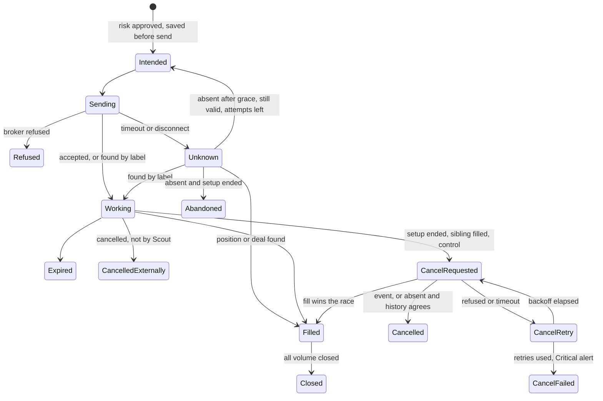
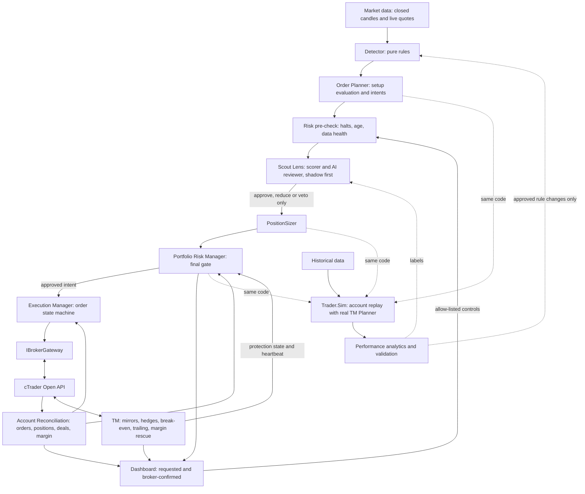
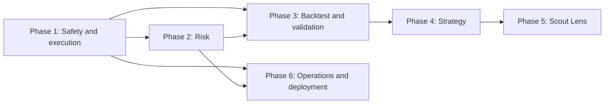

# Scout Bot: Independent Technical Review

| Item | Value |
|---|---|
| Report version | **v1.0 (08-Nov-2026)** |
| Reviewed | Trader `0a50a52`, Rewind `663aa94`, Scout spec v1.9; trial logs and account snapshots to 08-Nov-2026 |
| Reviewer | Claude Opus 5.5, for the owner |
| Brief | [audit-prompt.md](audit-prompt.md) v1.0 |
| All reviews, how to re-run | [reviews/README.md](README.md) |
| Status | Findings and recommendations only. Nothing here has been implemented |

**Verdict: Scout is a well-built demo system, but it has not shown a trading edge and does not yet control money at risk.** Fix cash-risk limits and order-state handling first. Then test the whole Scout and TM system on history before changing any entry rule.

**Reviewed:** Trader commit `0a50a52` (08-Nov-2026), Rewind `663aa94`, Scout spec v1.9, the live trial logs and read-only account snapshots. No repository, configuration or service was changed.

**Not verified:** I did not connect to any broker. Three broker behaviours remain unknown: whether cTrader de-duplicates by client order ID, how it treats a stop placed past the market, and Pepperstone's exact margin mode (inferred below). The dashboard's PHP tests were not run. Replay evidence covers 6 of the 18 symbols.

## A. Executive assessment

### What Scout does well

- **The detector is deterministic.** It uses closed candles only and has no broker dependency. I replayed 138 simulated restarts with 30 days of history on 6 symbols; all 4,911 setup events matched an uninterrupted run. A restart does not change the setups.
- **Demo-only is enforced in code.** `CTraderSession.ConnectAsync` rejects anything but demo or localhost replay, and `ConnectionManager.SelectAccounts` drops live accounts.
- **One writer per account.** `InstanceRegistry` uses an operating-system file lock, which is released even after a crash.
- **Orders can be recovered from the broker.** Labels carry timeframe, pause start and role, so reconciliation works across instances. All 75 live fills matched a placement row.
- **Every live order had a stop-loss and a server expiry:** 173 of 173.
- **Incidents changed the design.** The two entries in the issue log led to the account status read, the 3R backstop, the margin rescue and the spread guard.
- **Tests pass:** 319 of 319 .NET tests on an isolated clone.

### Biggest technical weaknesses

1. Scout's order states are incomplete. A timeout can permanently lose a setup, and a failed cancel is never retried (F-04, F-05).
2. `AccountScout` cannot be tested without a live session, so none of its order lifecycle has tests (F-20).
3. The machine and alerting depend on one laptop. Both bots were down from 00:46 to 06:13 PKT on 08-Nov with positions open (F-13).

### Biggest trading weaknesses

1. **No demonstrated edge.** The only long replay measures Scout's order with an immediate trailing stop: −0.20R per trade, 95 % interval −0.23R to −0.18R. That is not the system you run (F-12).
2. **The hedge overlay has not been shown to add value.** In the trial, excluding XNGUSD, main and mirror legs made +$536.60 and hedges lost $558.50, for a net −$22.00.
3. **A filter proposed in the spec is not supported by first data.** The shallowest retracements did worst (−0.24R), while 0.382–0.5 did better (−0.13R).

### The most serious risks

- **Money at risk is not limited.** Size is set per ATR and capped only by margin. Nothing limits cash risk per trade, per symbol, per correlated group, per day or for the portfolio (F-01, F-02).
- **The broker's minimum volume silently raises size.** XNGUSD at IC Markets was forced to 0.5 lot and lost $2,414.70. That is 99 % of the $2,436.69 realised loss of all Scout-started trades (F-03).
- **There is no account-level stop.** The IC Markets demo fell from $5,000 to $1,601.70 equity in five days and nothing halted new entries on loss (F-02).
- **Protection can be 3R, not 1R.** If a hedge is refused, the fallback is the backstop at three times the risk used for sizing (F-08).

### Can the architecture scale?

It scales to more symbols on H1 for one account. It does not yet scale to the planned multi-timeframe ladder, a risk manager or Scout Lens. Those need a separate decision pipeline, because `SyncAsync` currently combines strategy, risk and execution in one 100-line method. The fix is an incremental extraction, not a rewrite.

## B. Findings register

**Three P0 gaps and twelve P1 issues need action before Scout's results can be trusted.** Each finding starts with its status: **Bug** = wrong behaviour confirmed in the code; **Gap** = a missing control or a confirmed weakness; **Unverified** = a concern that needs a test. Paths are relative to the Trader repository unless marked Rewind. Bare file names are in `src/Trader.Scout`, except `Planner.cs`, `AccountManager.cs` and `TradeState.cs`, which are in `src/Trader.TM`.

| ID | Priority | Area | Finding | Evidence | Consequence | Recommendation |
| --- | --- | --- | --- | --- | --- | --- |
| F-01 | P0 | Risk | **Gap.** No cash-risk limit per trade, symbol, group or portfolio | `src/Trader.Scout/ScoutConfig.cs:15-21`; `AccountScout.cs:489` uses configured lots only | Median main-plus-mirror risk is about $32 at 1R and $97 at TM's 3R limit. One such trade on all 18 symbols is about 39 % of Pepperstone equity at 3R, before staircase entries | PositionSizer and Portfolio Risk Manager (P-02, P-03) |
| F-02 | P0 | Risk | **Gap.** No daily, weekly or portfolio loss halt and no global new-entry stop | `Controls.cs:63` knows 3 options only; a daily limit exists only in `docs/bots/auto-bot.md:71` | IC Markets demo equity fell from $5,000 to $1,601.70 in five days while new entries remained possible | Account halt with TM protection left running (P-04) |
| F-03 | P0 | Risk | **Bug.** The broker minimum silently raises order size | `src/Trader.Core/MarketData/SymbolCatalog.cs:35-40`; `Program.cs:261` only logs it | XNGUSD 0.5 lot was about 9 times intended risk and lost $2,414.70 at IC Markets | Reject when the minimum exceeds permitted risk (P-02) |
| F-04 | P1 | Execution | **Bug.** A timeout or disconnect while placing permanently skips the setup | `AccountScout.cs:571-572` marks before sending; `:587` catches broker errors only; `:438` then blocks it | A valid setup is lost with a blank result, no CSV row and no alert. Eight Scout cycle errors occurred in the trial | Intent state with broker confirmation (P-01) |
| F-05 | P1 | Execution | **Bug.** `_cancelling` keeps an order ID after refusal or timeout, so the cancel is never retried | `AccountScout.cs:599, 608, 617-621, 669` | Until restart, a one-cancels-other or dashboard cancel can silently fail. The order and TM's mirror stay live up to 16 candles | Cancel state machine (P-01) |
| F-06 | P1 | Dashboard | **Bug.** The dashboard can report a control as applied while the order is still live | `AccountScout.cs:168-172, 410-415` | Owner believes a symbol is off when its order can still fill | Report requested and broker-confirmed separately (P-10) |
| F-07 | P1 | Recovery | **Bug.** Reconciliation only repairs open positions | `AccountScout.cs:370-379`; deal and order history calls are unused by Scout. Live memory holds 13 `placed` roles while the broker has 0 pending orders | Fills, closes and expiries during downtime are missing from CSV and memory. Trial and Lens datasets are biased | History-based recovery (P-01) |
| F-08 | P1 | Risk with TM | **Gap.** If a hedge is refused, the fallback stop is at 3R while size assumes 1R | `src/Trader.TM/Planner.cs:691-695`; `docs/bots/tm.md` §5.1 | A refused hedge triples the loss per leg | Count unconfirmed protection at backstop risk (P-05) |
| F-09 | P1 | Margin | **Gap.** The margin factor is wrong for each state of a trade | `MarginBudget.cs:14-17`. Pepperstone margin $831.46 is close to larger-side $781, not sum $1,562 (inferred) | Hedges are over-reserved on larger-side margin and under-reserved on sum margin. Main and reversal are counted twice | Scenario-based margin model (P-05) |
| F-10 | P1 | Execution | **Bug.** Orders are sent with no check of the live price; replay and broker treat a passed level differently | 10 of 75 live fills came within 2 s of placing, with slippage up to 229 pips on XPTUSD. 0 of 173 refused live; Rewind refused 582 of 11,460 | Entries chase the market, and replay excludes trades that live takes | Quote check; align replay (P-01, P-06). Broker rule still to confirm |
| F-11 | P1 | Execution | **Gap.** Scout's entries have no spread or rollover guard | `AccountScout.cs:575-577`; issue-log #2 open item. Replay: fills 20:00–24:00 UTC average −0.45R; 04:00–08:00 UTC −0.06R | Entries are exposed at the worst hours | Test a rollover exclusion first (P-08) |
| F-12 | P1 | Backtest | **Gap.** The replay does not test the system that trades | Rewind `src/Rewind.Lab/Outcomes.cs:46, 144`; `scout-lens.md:278` | −0.20R describes immediate trailing, not TM's hedges and break-even. Lens would be trained on the wrong label | Full-system account replay (P-06) |
| F-13 | P1 | Operations | **Gap.** One laptop, user services without linger, desktop-only alerts | `Linger=no`; `~/tradebot/config/notifications.json`. Both bots down 00:46–06:13 PKT on 08-Nov | Open positions go unmanaged and nobody is told | Remote dead-man alarm, then VPS (P-11) |
| F-14 | P1 | Risk with TM | **Gap.** Scout does not check that TM is healthy before placing | No TM check in `AccountScout.SyncAsync` | Fills get no mirror or hedge, and the trade differs from what was tested | TM heartbeat as an entry gate (P-04) |
| F-15 | P1 | Testing | **Gap.** The order lifecycle has no automated tests | `AccountScout` takes the concrete `CTraderSession`; TM has `FakeBroker`, Scout does not | F-04 to F-07 went unnoticed; fixes cannot be proven | Broker gateway interface and fake (P-12) |
| F-16 | P2 | Execution | **Bug.** Duplicate orders with one key are hidden | `AccountScout.cs:367`, `Planner.cs:69-70` overwrite by key | Margin undercounted; only one duplicate is cancelled | Detect and alert on duplicates (P-01) |
| F-17 | P2 | Recovery | **Bug.** An exception mid-sync skips saving roles already placed | `AccountScout.cs:454` | Rare loss of memory if the process dies before the next save; labels mostly recover it | Save per transition (P-01) |
| F-18 | P2 | Execution | **Gap.** Client order ID is random | `AccountScout.cs:810` | Correlation only. The label is the usable idempotency key | Deterministic ID from role and attempt (P-01) |
| F-19 | P2 | Execution | **Gap.** An order is sent without a stop-loss when the far side is invalid | `AccountScout.cs:528-532` (0 live cases so far) | TM falls back to a default distance not derived from the setup | Skip and log (P-02) |
| F-20 | P2 | Execution | **Gap.** Old setups can be placed with a fresh 16-hour expiry | `AccountScout.cs:438-451, 560`; 7 orders on a Saturday after the broker move | Entries differ from those replay assumes | Maximum setup age (P-01) |
| F-21 | P2 | TM | **Bug.** A timeout on the market mirror leaves the trade unable to finish | `Planner.cs:433-443`; `AccountManager.cs:293`; `TradeState.cs:63` | No mirror and a trade record that never closes | Same intent pattern in TM (P-01) |
| F-22 | P2 | TM | **Gap.** Mirror orders have no server expiry | `AccountManager.cs:263-264` | With TM down, a mirror can outlive Scout's order and fill | Pass Scout's expiry through |
| F-23 | P2 | Margin | **Gap.** Scout's 50 % budget conflicts with TM's 300 % no-mirror rule | `ScoutConfig.cs:20`; `Planner.cs:42`; `config/tm.json:40` | Between 33 % and 50 % margin use, Scout adds trades TM will not mirror, so trade size changes silently | One shared limit (P-03) |
| F-24 | P2 | Margin | **Gap.** Margin is checked once and only for a single volume tier | `AccountScout.cs:480-485` | Volatility, leverage tiers and weekend changes are unseen | Periodic stress re-check (P-05) |
| F-25 | P2 | Sizing | **Gap.** Sizes reflect ATR on one day | `config/scout.json:41-58`; $/ATR now ranges about $10 to $18 on symbols checked | Risk drifts as volatility changes | Size from stop distance per order (P-02) |
| F-26 | P2 | Strategy | **Gap.** No minimum stop distance against spread | `Planner.cs:340` warns only. EURGBP −0.42R, commission alone 0.07R | Small pauses lose to costs | Test a minimum R in spreads (P-08) |
| F-27 | P2 | Strategy | **Unverified.** Trend definition does not grade regime or exhaustion | `Detector.cs:184-227`; no trend-age or strength field | Every pause is treated alike | Log features, then test (P-08) |
| F-28 | P2 | Architecture | **Gap.** Live and replay order rules are written twice | `ReplayOrders.cs:58-84` and `AccountScout.SyncAsync` | Silent drift between backtest and live | One shared order planner (P-09) |
| F-29 | P2 | Backtest | **Gap.** Rewind has no margin, account status or trigger fields | Rewind `config/rewind.json`; `OpenApiServer.cs`; `tm.md` §5.2 | TM's margin rules and Scout's orders cannot run against it | Extend Rewind (P-06) |
| F-30 | P2 | Backtest | **Unverified.** Four price steps per M5 bar can misorder entry and exit | Rewind `SimBroker.cs:140-142`; 2.3 % of trades open and close in one step | Short-distance trades may be mis-scored | Repeat on M1 data (P-07) |
| F-31 | P2 | Backtest | **Gap.** Two years and symbols chosen today | `scout-lens.md:272` | Selection bias and one market regime | Out-of-sample rules (P-07) |
| F-32 | P2 | Trial | **Gap.** The trial changed broker, symbols and sizes in five days, with 31 Scout instance log folders | `scout.md` §7; log folders | Trial numbers cannot be pooled | Freeze a baseline before reviewing |
| F-33 | P2 | Dashboard | **Gap.** Monitoring uploads every 30 minutes | `docs/dashboard/dashboard.md` §3.1 | Not usable as an alarm | Short heartbeat path (P-10) |
| F-34 | P2 | Controls | **Bug.** A timeout while changing timeframe leaves the change half-applied | `AccountScout.cs:187, 218` | Remaining charts not switched; no acknowledgement | Mark applied after success |
| F-35 | P2 | Security | **Gap.** Public repository exposes account numbers, owner address and infrastructure | `gh` reports public; `CLAUDE.md` account table | Helps targeted phishing. No credential found in Git history | Make private, or move identifiers out (P-11) |
| F-36 | P2 | Config | **Gap.** Setup settings are not validated | `ScoutConfig.Validated` skips `Setup` | A bad value changes trading silently | Range checks |
| F-37 | P3 | Execution | **Gap.** Expiry is wall-clock, not candles | `AccountScout.cs:560` | Fewer tradable candles across closes | Document or count market candles |
| F-38 | P3 | Security | **Gap.** No log retention rule; config folder is mode 775 | 25 MB today; files themselves are 600 | Minor | Retention policy; mode 700 |
| F-39 | P3 | Operations | **Gap.** A lost token-refresh reply needs a manual new token | `ConnectionManager.cs:202-205` | Long outage if it happens unattended | Alert and runbook |

**Investigated and cleared:**

- **Restart divergence:** none across 138 simulated restarts.
- **Duplicate order after a timeout, within one running process:** blocked today, but only because of bug F-04. A fix must keep this protection.
- **Races on `_cancelling`:** none, since it is used only on the single account loop.
- **Secrets in Git:** a history scan found one match, a deliberate test fixture. The tracked `web/dashboard/dev/.data/config.php` holds placeholder values only.
- **CSV and JSON writes:** rows are flushed per write and state is replaced by rename.

## C. Improvement proposals

**The first five proposals make order state and money at risk trustworthy; everything else depends on them.** Complexity is low (days), medium (one to two weeks) or high (several weeks) of focused work. Numeric limits are starting points to calibrate on replay, not recommendations to trade.

### P-01 Idempotent order lifecycle and reconciliation

**Problem.** Scout records an order's fate from local assumptions, not broker state (F-04, F-05, F-07, F-10, F-16, F-17, F-20).

**Current.** The role is saved as a key before sending. Later logic treats "key exists" as "handled". Only open positions are reconciled.

**Proposed.** Give each role an explicit state, persisted before and after every broker call. The label stays the idempotency key.



| Action | Timeout or lost reply | Retry policy |
| --- | --- | --- |
| Place | Mark `Unknown`. Never resend blindly | Wait at least 30 s and two reconciles, then check order and deal history. At most one resend, after a fresh check of level, age and live quote |
| Cancel | Stay in `CancelRequested` | 5 s, 15 s, 60 s, then every 5 min while the order exists. Critical alert after the third failure |
| Permanent refusal, such as bad stops | No retry | Record the broker code |
| `NOT_ENOUGH_MONEY` | No retry of the send | Re-enter through the risk gate only |

A deterministic client ID (`hash(key)-attempt`) aids correlation. Do not rely on the broker to de-duplicate until a demo test proves it. If two orders carry one key, cancel the newer and raise a Critical alert.

**Cancellation cases**

| Case | Today | Required |
| --- | --- | --- |
| Broker rejection | ID stuck, no retry | `CancelRetry`, then alert |
| API timeout | ID stuck, exception skips the CSV row | `CancelRetry`, then confirm from reconcile |
| Network disconnect | ID stuck until restart | Re-evaluate after reconnect |
| Accepted, reply lost | Row missing; memory unchanged | Absent from reconcile plus order history gives `Cancelled` |
| Filled during cancel | Logged as refused; ID stuck harmlessly | `Filled` wins; alert if the cancel was from a control |
| Restart during cancel | In-memory set lost; re-evaluated | Persisted state resumes |
| Dashboard off or skip | Can show applied while live | Acknowledge only after broker confirmation |
| TM cancels a Scout order | Logged as not by Scout; role stays `placed` | `CancelledExternally`, with a reason |

**Recovery after restart.** Read reconcile, then at least seven days of `GetOrdersAsync` and `GetDealsAsync`. Both exist in `CTraderSession` already.

| Item | Source of truth | Action |
| --- | --- | --- |
| Pending | Reconcile | Attach by label |
| Filled | Position or deal | Set position ID; write `filled` once, marked as recovered |
| Expired or cancelled | Order history | Set final state and CSV row |
| Rejected | Order history or execution event | Set `Refused` with the code |
| Partly closed | Deals by position ID | One row per deal ID |
| Position without memory | Label parse | Rebuild the role; alert |
| Earlier Scout instance | Label ignores instance ID (already works) | Treat as own |

**JSON, broker and CSV can disagree today** (13 stale `placed` roles prove it). Precedence should be broker, then local state, then CSV. Treat CSV as an append-only journal with de-duplication by deal ID, or by order ID plus event type.

**Source files.** `AccountScout.cs`, `ScoutState.cs`, new `OrderLifecycle.cs`; the same pattern in TM's `Planner.cs` and `AccountManager.cs`.

**Benefit.** No silent loss of setups, confirmed cancels and clean datasets. **Complexity.** Medium.

**Side effects.** The state file schema changes and needs a migration. More history requests at start.

**Tests.** Lost placement reply; late acceptance after timeout; failed and lost cancel; fill during cancel; restart at every state; duplicate events; duplicate label.

**Acceptance.** Every fault-injection test ends with one order at most and a correct final state. Memory, broker and CSV agree after a restart.

### P-02 PositionSizer

**Problem.** Size does not depend on the stop distance or the account (F-01, F-03, F-19, F-25). ATR parity is useful for comparing symbols, but it does not bound a loss: replayed stop distance runs from 0.57 to 2.05 ATR at the 5th and 95th percentiles.

**Current.** Static `lotsBySymbol`, raised to the broker's minimum.

**Proposed.** Size each order from the whole trade's risk, not Scout's leg alone.

```math
V = \mathrm{floor}_{step}\left(\frac{B}{L \times (|E - S| \times C + K + G)}\right)
```

B is the permitted cash risk for the trade. L is the number of legs (2 with a mirror). E and S are entry and initial stop. C is account currency per unit of price per lot, using the existing `FindConversion`. K is commission per lot for the round trip. G is an allowance per lot for spread and slippage.

Rules: round down to the step; **reject if V is below the minimum**; clamp to the maximum; reject when there is no valid stop or the stop is under a minimum number of spreads. Separately, reject when the 3R loss on all legs exceeds a hard cap.

Example: equity $4,467, whole-trade budget 0.5 % = $22.34, two legs, EURUSD stop 15 pips plus 1 pip of costs at $10 per pip per lot gives 0.0698, so 0.06 lot.

**Source files.** New `PositionSizer.cs`; `SymbolCatalog.cs`; `AccountScout.cs`; `ScoutConfig.cs`.

**Benefit.** A known loss per trade. **Complexity.** Medium.

**Side effects.** Tight stops get larger sizes, which changes results per dollar, so the full-system replay must use it.

**Tests.** Minimum above budget is rejected; step rounding; JPY, EUR and metal conversion; missing conversion refuses; zero or wrong-side stop.

**Acceptance.** No order's computed loss at stop exceeds budget on any of the 18 symbols. XNGUSD at a 0.5-lot minimum is refused.

### P-03 Portfolio Risk Manager

**Problem.** Eighteen symbols are treated as independent, and staircase entries multiply exposure (F-01, F-23). The replay reached 10 simultaneous positions on 6 symbols at one order per setup.

**Current.** Margin budget only.

**Proposed.** A pure function that approves, reduces or refuses each intent against broker-confirmed exposure.

| Item | How it counts |
| --- | --- |
| Scout and mirror positions | Distance to the confirmed server stop |
| Hedged leg with a confirmed hedge order | 1R plus a hedge-cycle allowance |
| Leg with only the backstop | Full 3R |
| Filled hedge | Frozen loss plus the risk to the hedge's stop |
| Scout and mirror pending | As if filled; main and reversal of one pause count once, at the larger |
| Manual positions | Counted, never touched |

| Group | Members | Note |
| --- | --- | --- |
| USD | EURUSD, GBPUSD, USDJPY | Direction-aware: long EURUSD and short USDJPY are both short USD |
| JPY | USDJPY, GBPJPY, EURJPY, AUDJPY | Often move together in risk-off markets |
| Metals | XAUUSD, XAGUSD, XPTUSD |  |
| US equity | US500, USTEC; DE40 as a soft member |  |
| Crypto | BTCUSD, ETHUSD, SOLUSD |  |
| Energy | XTIUSD, XBRUSD, XNGUSD | Oil pair tight; natural gas much looser |

Start with this static map. Add rolling correlation only if replay shows the map misses real clusters. The worst replay day was −10.3R with one order per setup on six symbols, so clusters are real.

| Limit | Demo start value, to calibrate | When reached |
| --- | --- | --- |
| Risk per trade, all legs | 0.5 % of equity | Reduce or refuse |
| Combined open and pending risk | 5 % | Refuse new |
| Per symbol | 1 % | Refuse new (caps the staircase) |
| Per correlated group | 2 % | Refuse new |
| Daily loss | 3 % | Halt new entries to next day |
| Weekly drawdown | 6 % | Halt until owner review |
| Portfolio drawdown from peak | 15 % | Halt until owner review |
| Margin use | 33 %, matching TM's 300 % level | Refuse new |
| Simultaneous trades | 8 | Refuse new |
| Pending orders | 12 | Refuse new |

**With TM.** The manager gates only new risk. It never blocks hedges, stops, break-even, closes or the margin rescue. TM publishes each trade's confirmed protection state so the manager reads one source. TM's no-mirror rule becomes an input to sizing, so a trade is not silently half-sized.

**Source files.** New `PortfolioRisk.cs` in `Trader.Core` or Scout; `AccountScout.cs`; a TM state export.

**Benefit.** Bounded, explainable exposure. **Complexity.** High.

**Side effects.** Fewer entries, which breaks "every pause gets an order". The owner must accept which setup is refused first.

**Tests.** Simultaneous setups across a group; pending pair counted once; manual position counted; limit reached; stale account status refuses.

**Acceptance.** In a replayed stress week, no limit is exceeded by more than slippage.

### P-04 Account halt and TM health gate

**Problem.** There is no account-level stop, and Scout ignores TM's health (F-02, F-14).

**Current.** Per-symbol switch and per-setup skip only.

**Proposed.** Three modes: **Normal**; **NoNewEntries** (cancels Scout's pending orders; TM continues); **ClosePositions** as a separate, explicit owner action. Triggers: loss limits, stale account status, stale candles, TM heartbeat older than 60 s, or owner command. A local command file must work without the website.

**Source files.** `Controls.cs`, `AccountScout.cs`, `config/scout-controls.json`, TM heartbeat.

**Benefit.** One reliable stop. **Complexity.** Low to medium.

**Side effects.** A brief TM restart will pause entries. Use a grace period.

**Tests.** Halt with open positions leaves TM managing them; TM down blocks new entries; recovery needs an explicit reset after a loss halt.

**Acceptance.** After a halt, broker state shows no Scout pending orders within one minute and every open leg still protected.

### P-05 Margin stress and confirmed protection

**Problem.** Static factor; a pending hedge is treated as protection although it can be refused at trigger (F-08, F-09, F-24).

**Current.** Equity × 50 % less used margin less 4 × waiting margin. Backstop at 3R.

**Proposed.** Read `TotalMarginCalculationType` and compute margin per scenario: pending, filled, mirrored and both hedges filled. Refuse a trade if free margin cannot carry its hedges after a stress of 2 × margin on crypto and metals, a 10 % equity fall and 5 × spread. Label each leg in TM as stop on server, hedge pending or unprotected. Treat "hedge pending" as protected only for sizing at backstop risk.

**Source files.** `MarginBudget.cs`, `AccountStatus.cs`, TM `Planner.cs`.

**Benefit.** Prevents a repeat of issue #1. **Complexity.** Medium.

**Side effects.** Lower capacity on brokers with sum margin or low symbol leverage (XPTUSD and SOLUSD are 1:10 at Pepperstone).

**Tests.** Sum, larger-side and net margin; hedge refused at trigger; tier change; weekend leverage.

**Acceptance.** A replayed issue #1 sequence ends with no refused hedge and no leg without a server stop.

### P-06 Full-system account replay

**Problem.** The replay answers a different question from the one that matters (F-10, F-12, F-29).

**Current.** One order per role, on a separate broker per symbol, with an immediate trailing stop and minimum volume.

| Your concern | Finding |
| --- | --- |
| TM lifecycle not simulated | Confirmed. Live, the stop is replaced by hedges and a backstop until 1R |
| Separate brokers per symbol | Confirmed (`Outcomes.cs:67`) |
| No portfolio margin | Confirmed (`rewind.json`: "margin is not simulated") |
| Configured volumes not used | Confirmed (`_spec.MinVolume`); R is unaffected, money is |
| Costs and contracts | Commission is modelled in the broker, but R ignores it: about 0.03R on average. Net is −0.23R. Pepperstone values not validated |
| Swap | Absent. Small for a 1.6-hour median hold, large for held trades |
| M5 path | Four steps per bar. M1 exists and is unused here |
| Bid, ask, gaps | Modelled, gaps at bar open only |
| Same rules live and in replay | Detector is shared; order rules are copied (F-28) |

**Proposed.** Build `Trader.Sim` in the Trader repository. It reads exported Rewind history and calls the real `Planner.Plan`, which is already a pure function. This respects Rewind's no-reference rule and avoids live-socket replay speed, which is about 5 s per 5-minute candle. It needs one merged clock across symbols and these parts: Scout entries, mirror orders, both hedges, fills and re-hedging, break-even, trailing, 2R and 3R rules, spread guard, trigger methods, commission, swap, margin by mode, refusals, margin rescue, stop-out, and simultaneous symbols.

**Source files.** New `src/Trader.Sim`; `ReplayOrders.cs`; TM internals; a Rewind export.

**Benefit.** The first true measure of the strategy. **Complexity.** High.

**Side effects.** Long runtime, and a model that must itself be validated.

**Tests.** Replays of issue #1 and issue #2; hand-checked trades; identical results from repeat runs.

**Acceptance.** A replay of a real trial week matches broker deals per trade within an agreed tolerance, and any gaps are explained.

### P-07 Statistical validation

**Problem.** No agreed test decides whether a change is real (F-30, F-31, F-32).

**Current baseline**, 6 symbols, Scout order with immediate trailing:

| Measure | Value |
| --- | --- |
| Trades | 6,076 |
| Mean R before commission (day-block bootstrap 95 %) | −0.201 (−0.228 to −0.175) |
| Win rate; profit factor | 29.2 %; 0.57 |
| Maximum drawdown at 1R per trade | −1,227R |
| Maximum consecutive losses | 20 |
| Worst day; worst trade | −10.3R; −7.08R |
| Trades worse than −1.2R | 2.0 % |
| Reached +1R; +2R | 26 %; 9 % |

| Symbol | Trades | Mean R | Profit factor |
| --- | --- | --- | --- |
| EURUSD | 963 | −0.046 | 0.88 |
| BTCUSD | 1,231 | −0.127 | 0.69 |
| ETHUSD | 1,232 | −0.131 | 0.68 |
| AUDJPY | 937 | −0.240 | 0.53 |
| GBPJPY | 890 | −0.323 | 0.39 |
| EURGBP | 823 | −0.421 | 0.28 |

Every half-year from 2024-H2 to 2026-H2 was negative (−0.15R to −0.23R).

**Proposed framework.** Split chronologically: development to Dec-2025, validation Jan–Jun 2026, and a locked out-of-sample period Jul–Oct 2026 used once. Extend history as far back as the data allows. Walk forward with a purge gap longer than a pause plus a typical hold. Report per symbol, group, year and regime: net expectancy, profit factor, drawdown, consecutive losses, MAE, MFE, exposure time, fill rate, slippage and tail loss. Use day-block bootstrap or Monte Carlo for intervals. Sweep each parameter by ±20 % and prefer plateaus. Keep a log of every experiment, so multiple-testing is visible.

**Pass rule for any change.** At least +0.05R net on validation, interval excluding zero improvement, working in at least two asset groups and not dependent on one symbol.

| Bias | Assessment |
| --- | --- |
| Look-ahead | None found in `ReplayOrders`: placed at candle close; 4H fed first only when closed. Daily direction from Claude would need strict point-in-time inputs |
| Leakage | Overlapping staircase trades; use the purge gap |
| Survivorship and selection | Today's top symbols; include excluded symbols as a control |
| Execution realism | F-10 removes 5 % of live-style fills. Dukascopy spreads differ from Pepperstone's |

**Source files.** New reports in `Trader.Sim`. **Benefit.** Fewer false discoveries. **Complexity.** Medium.

**Side effects.** Promising ideas will be rejected, which is the purpose.

**Tests.** Metric calculations on known series. **Acceptance.** One command reproduces the report.

### P-08 Strategy experiments

**Problem.** Rule proposals are ahead of the evidence.

**Current status of the proposals**

| Proposal | Status | Evidence |
| --- | --- | --- |
| Higher-timeframe tag (4H) | **Implemented**, logged only | `ChartTracker.cs` |
| Daily direction filter | **Documented only** | Scout spec §4.7 D1 |
| Daily, H4, H1 entry ladder | **Documented only**; each chart is still independent | §4.7 D2 |
| Retracement 0.382 and 0.5 sizing | **Partial**: pull-back logged, 0.6 cap active, no sizing | `Detector.cs:295` |
| One-candle pauses | **Partial**: `minPause` is configurable, default 2, untested | `Detector.cs:311` |
| 30M timeframe | **Documented only**; not in `Timeframes` | `ScoutConfig.cs:108-114` |
| 5M confirmation | **Documented only**; Rewind has the data | §4.8 |
| Monthly and daily context | **Documented only** | `scout-lens.md` §1.2 |

**What the first data says, under the trailing-exit model only**

| Slice | Result |
| --- | --- |
| With or against 4H | −0.19R or −0.21R: no difference |
| Main or reversal | −0.22R or −0.17R |
| Pull-back up to 0.382 | −0.24R, the worst, against the spec's "full size" |
| Pull-back 0.382–0.5 | −0.13R |
| Pull-back above 0.5 | −0.17R |
| Fill hour 04–08 / 20–24 UTC | −0.06R / −0.45R |
| Expired orders | 169 of 11,460: the 16-candle limit rarely matters |

**Weaknesses seen.** The trend rule is scale-free, which suits all asset classes, but it does not grade strength or age. It flips after a 3 ATR move or a channel break, so it is late by design. Sideways markets produce pauses and paired stops with no chop filter. The one-cancels-other link acts only after a fill and a sync, so both sides can fill in a fast reversal. Scout's stop stays where it was first placed while the detector's far side moves. Bid-based candles differ from ask-triggered buy stops. Gaps caused the −7.08R tail.

**Order of testing, each on the full-system replay**

| # | Experiment | Why in this order |
| --- | --- | --- |
| 1 | Baseline with TM and costs | Everything is compared with this |
| 2 | Exits: trailing from 1R, no immediate trailing, hedges on or off | Largest open question; trial hedges cost as much as legs earned |
| 3 | Rollover and session exclusion | Largest slice found; cheap |
| 4 | Minimum stop in spreads; symbol universe | Removes cost-dominated trades |
| 5 | Daily direction, rule-based | Spec's main idea; 4H showed no effect, so expect a modest result |
| 6 | Retracement bands | First data contradicts the rule |
| 7 | Staircase depth and trend age | Tests "every pause" directly |
| 8 | One-candle pauses | Adds trades; only worthwhile after a positive base |
| 9 | Ladder across D1, H4, H1 | Adds correlated exposure; needs P-03 first |
| 10 | 5M confirmation | Needs replay support and extra data |
| 11 | 30M | Highest cost burden; last |

Features already logged: pause height, move, pull-back, ATR, higher trend, role. To add at candle close: staircase step, trend age, swing and level distance, spread to ATR, session, news proximity, daily direction.

**Source files.** `Detector.cs` only after a pass; `Trader.Sim`. **Benefit.** Evidence-led rules. **Complexity.** Medium per experiment.

**Side effects.** Each filter may also remove staircase winners, as `scout-lens.md` warns.

**Tests.** Feature values use only closed data. **Acceptance.** Each experiment has a dated pass or fail record.

### P-09 Separate strategy, risk and execution

**Problem.** `SyncAsync` mixes all three, and replay copies part of it (F-15, F-28).

**Assessment of the current design.** A single loop per account avoids races. Atomic file replacement is correct. Serilog event names are consistent. Constructor injection is enough; a dependency-injection container would add nothing. Broker calls ignore cancellation tokens, which is acceptable because it lets a send finish on shutdown. Request pacing suits H1 but needs review for a multi-timeframe ladder.

**Proposed.** Extract pure stages: `OrderPlanner` (detector state to intents, shared with replay), `PositionSizer`, `PortfolioRisk`, then `ExecutionManager` behind an `IBrokerGateway`. Do this while fixing P-01, not as a separate rewrite.

**Source files.** `AccountScout.cs`, `ReplayOrders.cs`, `Trader.Core`. **Benefit.** Testable and identical logic. **Complexity.** Medium.

**Side effects.** Short-term regression risk; deploy after a dry run.

**Tests.** Live planner and replay planner give identical intents on stored candles. **Acceptance.** `ReplayOrders` holds no order rules of its own.

### P-10 Dashboard and operational monitoring

**Problem.** Status arrives every 30 minutes and does not separate request from broker confirmation (F-06, F-33).

| Area | Exists today | To add |
| --- | --- | --- |
| Account | Balance, equity, margin, level, positions, orders | Open cash risk, pending risk, daily realised and unrealised P&L |
| Scout | Setups, orders, pictures | Last candle fetched and processed per symbol, last successful order, failures, cancels awaiting confirmation, expired and refused counts, Scout-to-TM handoff |
| Risk | Margin colours | Limits used, by symbol and group, and violations |
| Controls | Per-symbol, per-setup, timeframe | Global entry stop; status Requested, Sent, Broker-confirmed or Failed |
| Health | Instance status files | Broker, market data and TM heartbeats with alarms |

A new-entry stop must leave TM running, as P-04 sets out. Send a heartbeat every minute through the existing 1-minute sync path, and let the website raise the alarm when it stops.

**Source files.** `Trader.DashboardExport`, `web/dashboard/api`, `web/dashboard/ui`, `ControlAck`. **Benefit.** Trustworthy view of the account. **Complexity.** Medium.

**Side effects.** More uploads to shared hosting.

**Tests.** A failed cancel displays as failed; a silent laptop raises an alarm. **Acceptance.** Unplugging the laptop produces an off-machine alert within 5 minutes.

### P-11 Deployment and security

**Problem.** Availability relies on a laptop, and alerts are on that same laptop (F-13, F-35, F-38, F-39).

| Item | Assessment |
| --- | --- |
| API credentials | Good: mode 600, outside Git, atomic refresh, masked in logs |
| Dashboard sign-in | Good by design: Google OIDC with PKCE, server-side roles, secure cookie. Not penetration-tested here |
| Machine sign-in | Good: secret stored as a hash, lockout. The `claude` account has administrator rights, so it can skip setups and switch symbols; consider a read-only default |
| Control channel | Good: laptop catalogue allow-list |
| Repository | Public, with account numbers and owner address. No credential found |
| Broker restriction | Token scope is trading across granted accounts; add a broker-side demo-only token when possible |
| Service restart | Sound, but `Linger=no` means services need a login after reboot |
| Log retention | No rule; only 25 MB now |
| Sleep and connectivity | Pop-ups only, on the affected machine |

**VPS assessment.** Worth doing before any live trial, and `shared.md` §4 already requires it. Benefits: uptime, lower latency, no sleep. Costs: patching, secret handling and backup. The Primary lock only works per machine, so the laptop and VPS must never trade one account at once. Use separate tokens and hosts for test and trial. Move TM first, or both together, never Scout alone.

**Source files.** `deploy/`, `scripts/`, `notifications.json`, `InstanceRegistry.cs`. **Benefit.** Continuity and awareness. **Complexity.** Medium.

**Side effects.** A cost, and more to administer.

**Tests.** Reboot, network loss, double-host refusal. **Acceptance.** Services return unattended after reboot, and a second host cannot act.

### P-12 Automated tests and CI

**Problem.** Execution paths are untested and nothing builds automatically (F-15).

**Proposed.** Create `IBrokerGateway` and a fault-injecting fake, like TM's `FakeBroker`. Required scenarios:

- [ ] Broker timeout
- [ ] Duplicate execution events
- [ ] Lost placement response
- [ ] Failed cancellation
- [ ] Restart during submission
- [ ] Restart during cancellation
- [ ] Fill while cancel pending
- [ ] Partial close
- [ ] Symbol disabled with open position
- [ ] TM disconnected
- [ ] TM cannot create a hedge
- [ ] Margin limit reached
- [ ] Stale candles
- [ ] Abnormal spread
- [ ] Broker disconnection
- [ ] Simultaneous setups

**GitHub Actions: yes.** Build and run all .NET and PHP tests on every pull request, plus a secret scan. It is low cost, and the suite takes seconds. Since work currently goes straight to `main`, it only protects if changes go through pull requests.

**Source files.** `tests/Trader.Scout.Tests`, `.github/workflows`. **Benefit.** Fixes can be proven. **Complexity.** Low to medium.

**Side effects.** A slightly slower change flow.

**Acceptance.** All listed scenarios pass in CI.

### P-13 Scout Lens

**Problem.** Lens would learn from an outcome that is not the real trade, on a base strategy with negative expectancy.

**Assessment.** The six-stage order is sound if the risk gate runs twice: cheaply before the AI, so no call is paid for a refused trade, and finally before sending. The approve, reduce or veto limit is technically sound if enforced in code: map the verdict to a multiplier of 1, 0.5 or 0, and take the minimum with the rule-based size. A reduced size below the broker minimum becomes a skip.

**One conflict to resolve.** `scout-lens.md` §1.2 lets Claude's daily picture set direction, which decides orders versus alerts. That is more than a veto and is hard to backtest. Use a rule-based daily direction first, as P-08 orders.

| Scorer topic | Recommendation |
| --- | --- |
| Target | Net expected R of the full trade, not win or loss. A classifier ignores payoff size |
| Sample | 6,076 trades on 6 symbols is workable but overlapping; effective size is smaller. Use the 18-symbol set |
| Features | Under 20, known at candle close; review importance for stability |
| Validation | Purged walk-forward; calibrate; report top-bucket net R |
| Drift and retraining | Monitor feature drift; retrain on a schedule, quarterly at most, and only promote on out-of-sample gains |
| ONNX | Suitable for C#; add a parity test against Python output |

| Reviewer topic | Recommendation |
| --- | --- |
| Inputs | Chart image plus a table of computed levels, each with an ID |
| Invented levels | Require citing level IDs; reject replies with unknown IDs |
| Output | Fixed JSON schema; repeat a sample to measure consistency |
| Versions and audit | Pin the model; hash the prompt and caveats; log every request and reply |
| Failure | Timeout gives a logged no-verdict. In shadow it changes nothing; before go-live decide whether failure means rules alone or skip |
| Cost | Project estimates are unmeasured; measure in phase a |
| Shadow evaluation | Compare net R of vetoed and kept trades, including winners lost |

Phase a uses `claude -p` and phase b the API, so the runtime differs slightly. Re-validate on the API before relying on results.

**Source files.** `scout-lens.md`, future `ai.csv`. **Benefit.** A controlled path for judgment. **Complexity.** High.

**Side effects.** Dependency and overfitting risk.

**Tests.** Malformed replies, timeouts, unknown level IDs, attempt to increase size. **Acceptance.** Shadow results beat the rules on locked data, net of cost.

### P-14 Persistence: keep JSON for now

**Problem.** Would SQLite help?

|  | JSON now | SQLite |
| --- | --- | --- |
| Atomic single-record updates | Yes, by rename | Yes |
| Atomic multi-record changes | No | Yes |
| Query history and exposure | Poor | Good |
| Crash recovery | Good for one file | Good with write-ahead logging |
| Added complexity | None | Schema migrations, backup, a driver, two bots |

**Recommendation.** Keep JSON through P-01, since Scout makes few writes and has one writer, and save on each state change. Reconsider when the risk manager needs joined history or Lens needs order-level joins. The broker stays the source of truth either way.

**Source files.** `ScoutState.cs`. **Benefit.** Avoids a migration without a present need. **Complexity.** None now.

**Side effects.** Reporting stays file-based.

**Tests.** State migration test in P-01. **Acceptance.** Decision reviewed at Phase 3.

## D. Proposed target architecture

**Each new setup passes one pipeline of small stages, and only the Execution Manager talks to the broker.** TM stays independent, so protection continues when Scout or the risk layer stops. Replay uses the same planner, sizer and risk code as live trading.



The risk check runs before Lens to avoid paying for a refused trade, and again after sizing as the final gate. A halt blocks only the path into the Execution Manager. It never reaches TM's protective actions.

## E. Prioritised implementation roadmap

**Do not start strategy work until the replay matches real trades.** Phases 1 and 3 are the critical path, and Phase 3 can begin once the shared planner exists.



| Phase | Contents | Dependencies | Completion criteria |
| --- | --- | --- | --- |
| **1. Immediate safety and execution** | Refuse size raised by broker minimum (F-03). Global new-entry halt with loss limits (P-04). Broker gateway and fake (P-12). Placement and cancel state machines, recovery, quote check (P-01). CI. Remote dead-man alarm (from P-11) | None | All 16 listed fault scenarios pass in CI. Two demo weeks with zero mismatch between broker, memory and CSV. A halt test leaves every leg protected |
| **2. Risk management** | PositionSizer (P-02). Portfolio Risk Manager and limits (P-03). Margin scenarios and protection state (P-05). TM health gate. One shared margin limit | Phase 1 state and gateway | Every order has a computed loss within budget. Exposure by symbol and group is visible. A stress week breaches no limit |
| **3. Backtesting and validation** | Shared Order Planner (P-09). `Trader.Sim` (P-06). Validation report on all 18 symbols (P-07) | Planner from Phase 1; sizer and risk code from Phase 2 | A real trial week matches broker deals within tolerance. Issue #1 and #2 reproduce. A full-system baseline exists with net R and drawdown |
| **4. Strategy improvements** | Experiments 1 to 11 in order (P-08), then accepted rule changes through the Scout spec | Phase 3 baseline | Each experiment has a recorded pass or fail. Either locked-data net expectancy is positive, or a recorded decision is taken to redesign or stop |
| **5. Scout Lens and AI** | Dataset from full-system outcomes. Plain-filter baseline. Scorer, then reviewer in shadow (P-13) | Phase 3 labels and a Phase 4 base worth filtering | Shadow results beat rules on locked data net of cost, and vetoed trades did measurably worse |
| **6. Operational maturity and deployment** | Dashboard requested and confirmed states (P-10). VPS with separate test environment (P-11). Repository privacy. Retention. Persistence review (P-14) | Phases 1 and 2 | Unattended reboot and network-loss tests pass. Off-machine alerts arrive within 5 minutes |

## F. GitHub issue backlog

**Twenty-one issues, in recommended order, each ready to copy into GitHub.** None has been created.

```markdown
# Refuse orders when the broker minimum raises the size
**Priority:** P0
**Problem:** SymbolInfo.VolumeForLots raises a size below the minimum. XNGUSD at 0.5 lot lost $2,414.70 at IC Markets.
**Scope:** Scout order placement only. Leave TM's use of existing positions unchanged.
**Files likely to be affected:** src/Trader.Core/MarketData/SymbolCatalog.cs, src/Trader.Scout/AccountScout.cs, src/Trader.Scout/Program.cs
**Implementation notes:** Add a method that returns no volume instead of raising it. Log a skip row with the reason.
**Test cases:** Below minimum is refused; exact minimum allowed; step rounding is downward.
**Acceptance criteria:** No order is sent with a volume above the requested lots.
```

```markdown
# Add an account-level new-entry halt and loss limits
**Priority:** P0
**Problem:** Nothing stops new entries on a daily, weekly or portfolio loss, and there is no global stop.
**Scope:** Modes Normal and NoNewEntries, loss triggers, local and dashboard command. TM keeps managing positions.
**Files likely to be affected:** src/Trader.Scout/Controls.cs, src/Trader.Scout/AccountScout.cs, config/scout.json, config/scout-controls.json
**Implementation notes:** Measure from a persisted day-start and peak equity. Require an explicit reset after a loss halt. Must work without the website.
**Test cases:** Each limit triggers; halt cancels pending Scout orders; TM still acts; restart keeps the halt.
**Acceptance criteria:** Within one minute of a halt the broker shows no Scout pending orders and every open leg stays protected.
```

```markdown
# Add PositionSizer based on cash risk at the initial stop
**Priority:** P0
**Problem:** Size is fixed per symbol and does not reflect the stop distance or the account.
**Scope:** Sizing for Scout entries, including the mirror leg, costs and currency conversion.
**Files likely to be affected:** new src/Trader.Scout/PositionSizer.cs, src/Trader.Scout/ScoutConfig.cs, src/Trader.Scout/AccountScout.cs, src/Trader.Core/MarketData/SymbolCatalog.cs
**Implementation notes:** Use the report's P-02 formula. Round down. Refuse below minimum, on invalid or missing stop, and on stops under a minimum in spreads. Keep behind a config switch for comparison.
**Test cases:** USD, JPY, EUR and metal symbols; missing conversion refuses; maximum clamp; zero stop.
**Acceptance criteria:** Computed loss at stop is within budget on all 18 symbols.
```

```markdown
# Introduce IBrokerGateway and a fault-injecting fake for Scout
**Priority:** P1
**Problem:** AccountScout depends on CTraderSession, so its order lifecycle cannot be tested.
**Scope:** Interface for Scout's broker calls and a fake broker. No behaviour change.
**Files likely to be affected:** src/Trader.Scout/AccountScout.cs, src/Trader.Core/OpenApi, tests/Trader.Scout.Tests
**Implementation notes:** Follow tests/Trader.TM.Tests/FakeBroker.cs. Support delayed, lost and duplicated replies.
**Test cases:** The fake reproduces F-04 and F-05 before they are fixed.
**Acceptance criteria:** A full Scout sync runs in a unit test with no network.
```

```markdown
# Replace the placement memory with an explicit order state machine
**Priority:** P1
**Problem:** A timeout permanently marks a setup handled, and an exception can skip the save.
**Scope:** States Intended, Sending, Unknown, Working, Refused, Abandoned. Save on each transition. Maximum setup age. Deterministic client ID.
**Files likely to be affected:** src/Trader.Scout/AccountScout.cs, src/Trader.Scout/ScoutState.cs
**Implementation notes:** Never resend until the grace period ends and reconcile plus history show no order. Migrate the existing state file.
**Test cases:** Lost reply with order accepted; lost request; late acceptance; restart at each state; old setup refused.
**Acceptance criteria:** At most one order per role in every fault test, and no silent loss of a valid setup.
```

```markdown
# Make cancellation confirmed by broker state
**Priority:** P1
**Problem:** A failed cancel leaves the ID in _cancelling and is never retried.
**Scope:** Persisted CancelRequested and CancelRetry states, backoff, Critical alert, fill-wins handling.
**Files likely to be affected:** src/Trader.Scout/AccountScout.cs, src/Trader.Scout/Controls.cs
**Implementation notes:** Remove the in-memory set. Confirm by event, or by absence from reconcile plus order history.
**Test cases:** Refusal; timeout; disconnect; accepted with lost reply; fill during cancel; restart; TM cancels first.
**Acceptance criteria:** Each case reaches a correct final state, and a sibling cannot remain live without an alert.
```

```markdown
# Recover orders, deals and closes from broker history after any gap
**Priority:** P1
**Problem:** Events during downtime are lost; roles stay "placed" after expiry or close.
**Scope:** History read on start and reconnect, role final states, CSV rows marked as recovered, duplicate label alert.
**Files likely to be affected:** src/Trader.Scout/AccountScout.cs, src/Trader.Scout/ScoutState.cs
**Implementation notes:** Use GetOrdersAsync and GetDealsAsync. De-duplicate rows by deal ID or order ID plus event type.
**Test cases:** Fill and close during downtime; expiry during downtime; partial close; earlier instance; duplicate events.
**Acceptance criteria:** After a restart, memory, broker and CSV agree.
```

```markdown
# Check the live quote before placing a stop order
**Priority:** P1
**Problem:** 10 of 75 live fills came within 2 seconds of placing, some with large slippage; Rewind refuses these same orders.
**Scope:** Quote check, defined policy for a passed level, a one-off demo test of broker behaviour, matching change in Rewind.
**Files likely to be affected:** src/Trader.Scout/AccountScout.cs, Rewind src/Rewind/Broker/SimBroker.cs
**Implementation notes:** Requires a spot subscription or a cheap price read for Scout's symbols. Decide skip or accept with a tolerance after the demo test.
**Test cases:** Level passed; within spread; stale quote refused.
**Acceptance criteria:** Live and replay apply the same documented rule.
```

```markdown
# Build the Portfolio Risk Manager
**Priority:** P1
**Problem:** Risk is not aggregated across trades, legs or correlated symbols.
**Scope:** Exposure accounting, static groups, limits from report P-03, one margin limit shared with TM.
**Files likely to be affected:** new PortfolioRisk.cs, src/Trader.Scout/AccountScout.cs, src/Trader.TM state export, config/scout.json
**Implementation notes:** Pure function using broker-confirmed data. Gates new risk only.
**Test cases:** Group limit; main and reversal counted once; manual position counted; stale data refuses; all symbols fire together.
**Acceptance criteria:** No limit is exceeded in a replayed stress week by more than slippage.
```

```markdown
# Model margin by scenario and record each leg's confirmed protection
**Priority:** P1
**Problem:** A fixed factor of 4 is wrong by margin mode, and a pending hedge can be refused at trigger.
**Scope:** Margin by broker mode, stress test, protection state per leg, periodic re-check.
**Files likely to be affected:** src/Trader.Scout/MarginBudget.cs, src/Trader.Core/OpenApi/AccountStatus.cs, src/Trader.TM/Planner.cs
**Implementation notes:** Size unconfirmed protection at backstop risk.
**Test cases:** Sum, larger-side and net margin; refused hedge; leverage tier change.
**Acceptance criteria:** The issue #1 sequence ends with no leg lacking a server stop.
```

```markdown
# Block new Scout entries when TM is unhealthy
**Priority:** P1
**Problem:** Scout places orders without knowing TM is running.
**Scope:** TM heartbeat file and a Scout entry gate with a grace period.
**Files likely to be affected:** src/Trader.TM/AccountManager.cs, src/Trader.Scout/AccountScout.cs
**Implementation notes:** Reuse the instance registry if suitable.
**Test cases:** TM stopped; TM restarted within grace; TM stale.
**Acceptance criteria:** No new Scout order is sent while TM's heartbeat is stale.
```

```markdown
# Add a remote dead-man alarm
**Priority:** P1
**Problem:** Alerts are desktop-only, so a dead laptop reports nothing.
**Scope:** One-minute heartbeat through the existing sync, website-side stale check, one off-machine channel.
**Files likely to be affected:** scripts/dashboard-sync.sh, web/dashboard/api, config/notifications.json, src/Trader.Core/Notifications
**Implementation notes:** The alarm must be raised from outside the laptop.
**Test cases:** Stopped timer; network loss; service stopped; recovery message.
**Acceptance criteria:** Unplugging the laptop produces an alert within 5 minutes.
```

```markdown
# Build Trader.Sim, a full-system account replay
**Priority:** P1
**Problem:** The replay measures an immediate trailing stop, not Scout with TM.
**Scope:** Merged-clock simulator using the real Planner, hedges, costs, swap, margin, refusals and stop-out on all symbols.
**Files likely to be affected:** new src/Trader.Sim, src/Trader.TM, Rewind export tools
**Implementation notes:** Export history as files to respect Rewind's no-reference rule. Support M1 for sensitivity.
**Test cases:** Issue #1 and #2 reproduction; hand-checked trades; deterministic repeats.
**Acceptance criteria:** A real trial week matches broker deals within agreed tolerance.
```

```markdown
# Share one order planner between live and replay
**Priority:** P2
**Problem:** ReplayOrders repeats the rules in AccountScout.SyncAsync.
**Scope:** Extract OrderPlanner; both paths use it.
**Files likely to be affected:** src/Trader.Scout/AccountScout.cs, src/Trader.Scout/ReplayOrders.cs
**Implementation notes:** Keep the planner free of I/O.
**Test cases:** Identical intents on stored candles.
**Acceptance criteria:** ReplayOrders holds no order rules of its own.
```

```markdown
# Produce a reproducible validation report
**Priority:** P2
**Problem:** No agreed test decides whether a rule change is real.
**Scope:** Chronological splits, walk-forward, bootstrap, sensitivity and an experiment log.
**Files likely to be affected:** src/Trader.Sim, scripts/
**Implementation notes:** Keep the locked period for final use only. Include M1 comparison.
**Test cases:** Metrics on known series.
**Acceptance criteria:** One command reproduces all report figures.
```

```markdown
# Fix TM mirror expiry and mirror timeout handling
**Priority:** P2
**Problem:** Mirror orders have no expiry, and a timed-out market mirror leaves a trade that cannot finish.
**Scope:** Copy expiry to the mirror; apply intent handling to mirror orders.
**Files likely to be affected:** src/Trader.TM/AccountManager.cs, src/Trader.TM/Planner.cs, src/Trader.TM/TradeState.cs
**Implementation notes:** Existing mirrors keep current behaviour until cancelled.
**Test cases:** TM down at Scout's expiry; lost mirror reply.
**Acceptance criteria:** Every trade reaches Done, and no mirror outlives its main order.
```

```markdown
# Run build and tests in GitHub Actions
**Priority:** P2
**Problem:** Nothing builds or tests automatically.
**Scope:** .NET and PHP tests and a secret scan on pull requests.
**Files likely to be affected:** new .github/workflows/ci.yml
**Implementation notes:** Must use no broker or production secret. Protect main so changes pass through pull requests.
**Test cases:** A failing test blocks merge.
**Acceptance criteria:** Every pull request shows a required green check.
```

```markdown
# Show requested and broker-confirmed states on the dashboard
**Priority:** P2
**Problem:** A control can show as applied while its order is live.
**Scope:** Control status values, per-control order outcomes, risk and health panels from report P-10.
**Files likely to be affected:** src/Trader.Scout/Controls.cs, src/Trader.DashboardExport, web/dashboard/api, web/dashboard/ui
**Implementation notes:** Extend ControlAck in a backward-compatible way.
**Test cases:** Failed cancel displayed; pending confirmation displayed.
**Acceptance criteria:** No control shows confirmed until the broker state agrees.
```

```markdown
# Validate setup settings and make control changes retryable
**Priority:** P2
**Problem:** Setup values are unchecked, and a timeframe change can stop halfway.
**Scope:** Range checks; set the applied stamp only after success.
**Files likely to be affected:** src/Trader.Scout/ScoutConfig.cs, src/Trader.Scout/AccountScout.cs
**Implementation notes:** Refuse start on invalid settings.
**Test cases:** Bad values; timeout mid-change; retry.
**Acceptance criteria:** A failed change is retried and acknowledged.
```

```markdown
# Reduce information in the public repository
**Priority:** P2
**Problem:** The public repository holds account numbers, the owner's address and infrastructure details.
**Scope:** Decide private or public; move identifiers to local config if it stays public.
**Files likely to be affected:** CLAUDE.md, docs/shared.md, config/*.json
**Implementation notes:** History still holds old values, so going private is simpler.
**Test cases:** Secret and identifier scan.
**Acceptance criteria:** The owner's decision is recorded and applied.
```

```markdown
# Add log retention, tighter folder modes and a token-recovery runbook
**Priority:** P3
**Problem:** No retention rule, a config folder at mode 775, and no runbook for a lost refresh reply.
**Scope:** Retention job, modes, runbook; document wall-clock expiry.
**Files likely to be affected:** scripts/, deploy/, docs/shared.md
**Implementation notes:** Follow the existing rule not to delete audit logs without the owner's approval.
**Test cases:** Retention dry run.
**Acceptance criteria:** Documented and scheduled.
```

## G. What NOT to build yet

**Do not add anything that makes results harder to measure before the full-system baseline exists.**

| Do not build yet | Why |
| --- | --- |
| More technical indicators | The problem is unmeasured exits and costs. New indicators add parameters without a valid test |
| Daily ladder, 30M or 5M rules in live trading | All are untested, and the ladder adds correlated exposure before there is a risk manager |
| Half-size at 0.382–0.5 | First data points the other way; test it first |
| Filters from single replay slices | The rollover and pull-back results are leads, not rules |
| Claude reviewer with order authority | Keep it in shadow until it beats the rules on locked data |
| Claude-set daily direction | It is effectively a directional decision that is hard to backtest; start with a rule |
| LightGBM in production | A scorer on the wrong label would learn the wrong behaviour |
| End-to-end deep learning or chart scanner | Agreed in `scout-lens.md`: too little data, too little value |
| Parameter optimisation | Only sensitivity bands now; best-cell tuning fits noise |
| Rolling correlation engine | The static group map is enough to begin |
| SQLite migration | No present need (P-14) |
| Microservices, message bus or a DI container | One process per bot with a clean internal pipeline is enough |
| Automatic position closing on loss limits | Stop new entries first; closing should remain TM's rules or an explicit owner action |
| Real-money trial | The conditions below are not met |

## Final assessment

**Keep Scout on demo. Fix risk and order state, then measure the whole system before deciding whether the strategy deserves more work.**

**1. Is Scout's current strategy demonstrating a credible trading edge?** No. The tested variant loses about 0.20R per trade on all six symbols and every half-year. The real system with TM is unmeasured over history, and the five-day trial is too small and changed too often. Without XNGUSD it netted −$22.00.

**2. What is the biggest financial-risk weakness?** Nothing limits cash at risk, per trade or in aggregate. Margin is the only cap, and it is not a measure of loss.

**3. What is the biggest software-engineering weakness?** Order state is inferred from local memory rather than confirmed from the broker, and that code has no tests.

**4. What should be fixed immediately?** The minimum-volume size increase, a global new-entry halt with loss limits, the placement timeout bug, the stuck-cancel bug, and an off-machine alarm.

**5. What should be tested before changing the strategy?** A full-system baseline with TM, costs and margin. Then exits and hedging, because the trial suggests hedges may consume the legs' profit. Then rollover exclusion.

**6. What should be deferred?** Everything in section G: the entry ladder, 30M and 5M rules, Lens order authority, parameter optimisation and SQLite.

**7. What conditions should be met before considering a live-account trial?** I do not recommend live trading now. All of the following should be true first:

- [ ] Phases 1 and 2 are complete, and all fault tests pass.
- [ ] The full-system replay matches real demo trades within tolerance.
- [ ] Net expectancy is positive on locked data, with the interval above zero and costs included.
- [ ] A frozen configuration completes at least three months of demo forward testing with results consistent with replay.
- [ ] Forward testing has no unexplained state mismatch and no unprotected leg.
- [ ] Maximum drawdown stays within a pre-agreed limit.
- [ ] Halt, TM failure and broker disconnect have been rehearsed.
- [ ] Scout and TM run on a monitored VPS with off-machine alerts.
- [ ] Broker contract, margin and cost assumptions are validated for the actual account.
- [ ] The go-live decision, account size and limits are recorded as `shared.md` §4 requires.

### Top 10 recommendations, by expected impact

| Rank | Recommendation | Addresses | Proposal |
| --- | --- | --- | --- |
| 1 | Limit cash risk per trade and refuse sizes raised by broker minimums | F-01, F-03 | P-02 |
| 2 | Add an account-level new-entry halt with loss limits, leaving TM active | F-02 | P-04 |
| 3 | Build the full-system account replay with TM, costs and margin | F-12, F-29 | P-06 |
| 4 | Make orders and cancels an explicit, broker-confirmed state machine | F-04 to F-07 | P-01 |
| 5 | Add portfolio limits by symbol, correlated group and total risk | F-01, F-23 | P-03 |
| 6 | Test exits and whether hedging adds value | F-12 | P-08 |
| 7 | Add a test harness for Scout's execution, and CI | F-15 | P-12 |
| 8 | Add off-machine alarms, then move both bots to a VPS | F-13 | P-11 |
| 9 | Base margin on broker mode and confirmed protection | F-08, F-09 | P-05 |
| 10 | Adopt a fixed validation process before any rule or AI change | F-30 to F-32 | P-07 |
