# Scout Lens — an AI layer for Scout

**A layer after Scout's detector that decides, for each setup the rules find, whether to take it, skip it or trade it smaller.** Five ways to build it, each with its pros and cons and two example charts. **Decided (owner, 07-Nov-2026): options 1 and 3 together (choice A, §8); option 3 in two phases — tuning on the laptop, then API calls from Scout (§4.1).** Step 1 (the dataset) is being built (§8.1). Part of [Scout](scout.md).

| Item | Value |
|---|---|
| Status | **Decided — options 1 + 3** (owner, 07-Nov-2026); option 3 in two phases (§4.1). **Building: §8 step 1 started 08-Nov-2026** — the replay dataset with outcomes in R runs on Rewind (§8.1); first full run on all 18 symbols done (08-Nov-2026): −0.14R per trade, no asset group clearly positive. Planned: the §1.2 tags, near-miss rows (§1.1), phase a's laptop loop (§9) |
| Document version | v1.12 (09-Nov-2026) |
| Interactive version | [claude.ai artifact](https://claude.ai/artifact/9ChjnZcXq2w6j7BeomXNet) (private; same content, charts with hover) and [`docs/scout-lens.html`](https://github.com/ziash/Scout/blob/main/docs/scout-lens.html) in the Scout repository — both show v1.1, before the decision |
| Charts | [`docs/bots/scout/images/`](images) — all candle charts use **made-up candles** to show the idea; scores and R values on them are examples, not results |

## 1. Why a layer

Scout's C# rules (`Detector.cs`, started from Scout_Pine's rules) find every pause. They can't weigh the small things the owner sees on the chart: a pause just under last week's high, a move that has already run too far, a messy pause. The layer sits here:

```
1H candles  →  Detector (C# rules, unchanged)  →  candidate: setups.csv row + order picture  →  Scout Lens: take · skip · smaller  →  Buy Stop / Sell Stop, then TM
```

The rules stay the safety net: the layer can only **remove or shrink** an order the rules already wanted; it never makes one up. That leaves the other gap — setups the detector never passes on — which §1.1 covers.

**Terms used below**

- **R** — profit or loss measured in units of the risk taken: the distance from entry to stop-loss. +1R = won what was risked; −1R = a full loss.
- **ATR** (Average True Range) — the typical size of one candle's move; Scout already measures pause height and move in ATR.
- **Model** — a formula a program learns from examples, instead of one we write by hand.
- **Overfitting** — a model or setting that fits the past by luck (it learned the noise) and then fails on new data.
- **Backtest / replay** — running Scout over past candles to see what it would have done.
- **Shadow mode** — the layer gives its verdict and it is logged, but it changes no order; we compare afterwards.
- **Near-miss** — a pause that fails one of the detector's rules by a small margin, so the rules don't count it as a setup.

### 1.1 Setups the detector never passes on (owner, 07-Nov-2026)

The flow above runs one way: Scout Lens sees only what the detector found. A formation the rules miss never reaches it. Three additions close that gap without letting the layer place orders:

```
                    ┌──────────── rule change, through the Scout spec ◄─────────────┐
                    ▼                                                               │
1H candles  →  Detector  →  setups + near-misses  →  Scout Lens  →  verdicts (ai.csv)
                    ▲                                                               │
owner marks a "missed" formation  →  missed-setup check  →  real misses ───────────►┘
```

**First, a check of what looks missed.** On GBPUSD 1H (05–06 Nov 2026) two earlier pauses of a down move looked skipped on the order picture. Scout's logs show the detector found both: the first was filled and stopped out an hour later, the broker refused the second for lack of margin ([issue #1](../../issue-log.md#1-ic-markets-demo-in-a-margin-call-06-nov-2026)). Not a detector gap, but the picture didn't show it — the order picture now does (07-Nov-2026) ([scout.md §3.1](scout.md#31-order-pictures-owner-04-nov-2026), *other Scout orders*). The same history (this is the 3rd step; the 1st was stopped out) is an input to the scorer and the reviewer.

| # | Addition | What it does | Status |
|---|---|---|---|
| 1 | **Missed-setup check** | The owner marks a formation they expected Scout to take (a symbol, timeframe and candle, e.g. from the dashboard picture). It is matched against the logs and sorted into one of five cases: **not found** by the detector · found but **cancelled** (with the reason, e.g. "pause too long or too deep") · **refused** by the broker · **filled and stopped out** · **held back** (margin budget or a control). Only *not found* — and *cancelled* where the owner disagrees with the reason — are detector gaps. Each case is kept in `missed.csv` with the owner's note. | Planned — first by hand (Claude reads the logs), later a button on the dashboard picture |
| 2 | **Near-miss rows** | The detector also logs pauses that fail **one** rule by a small margin, as a new event `NearMiss` in `setups.csv`, with the rule and by how much — e.g. a move of 1.3 ATR where `minMove` is 1.5; a pull-back of 0.65 where `maxRetrace` is 0.6; a pause 3.3 ATR high where `maxPauseHeight` is 3.0. Margins set in `scout.json`. **Logging only:** no order, no change to the events Scout_Pine matches. In shadow mode Scout Lens reviews near-misses like setups (scorer score, Claude verdict) and the replay gives each its outcome in R. | Planned |
| 3 | **Back to the rules** | When missed-setup cases or near-misses of one kind keep coming up and would have paid (in R, over enough cases), the fix is a **rule change**: written in the Scout spec, then built and tested in `Detector.cs` (as for every rule change; Scout_Pine is closed for development, owner 07-Nov-2026). Scout Lens never turns a near-miss into an order itself. | The way every change goes |
| — | *Chart scanner (later option)* | *Claude reads each whole chart every few hours, independent of the detector, and lists formations it sees; shadow only. Costs more than reviewing single setups. Only worth it if the missed-setup check shows many real misses.* | *Not planned* |

### 1.2 Daily first: the monthly and daily pictures (owner, 07-Nov-2026)

The owner reads the charts top-down: **the daily and monthly charts set the direction and the key support/resistance levels; entries come from the pauses on the daily chart and every chart down to the one Scout is set on** — on 1H: daily, 4H and 1H; the higher ones give the first entry, the lower ones scale the position up, only in the daily direction (rules: Scout spec §4.7, D1–D5 and the entry ladder; 0.382–0.5 retracement = half size). Rules find the pauses and measure the retracement depth; which levels are *good* zones and the direction they imply is judgment, so it goes to Claude, from two pictures per symbol:

| Picture | Shows | Refreshed | Claude writes |
|---|---|---|---|
| **Monthly** | Monthly candles, several years | Once, when a new monthly candle opens; it replaces the old one | The big zones: where a daily move is likely to stop or turn |
| **Daily** | Daily candles, about a year, with the monthly zones drawn in | Every day after the daily close; it replaces the old one | Direction (up · down · range) and the key daily levels (e.g. "support that held twice, now resistance"), with why |

- **One current picture per timeframe and symbol.** Old pictures are not kept; a level that still matters is carried forward as text in the context file (most are already in the monthly zones).
- **Output:** one context file per symbol (e.g. `~/tradebot/run/lens/context-<symbol>.json`: direction, zones, picture dates, model). Scout reads it: pauses against the direction become alerts with the reason "against daily" (D1); pauses with it, on any chart of the entry ladder, become orders while **Automatic orders** is on (D2, a dashboard switch, on for the demo test). The zones are inputs for the scorer and the reviewer (e.g. a stop right next to a tested level, §4).
- **Without a context file** (Claude down, a new symbol), Scout runs as today, and says so in its log.
- **Cost:** 18 symbols × one daily picture ≈ 400 reviews a month, plus 18 monthly; a few dollars a month on the API (estimate). Not time-critical, so phase a (§4.1) can run it on the laptop after the daily close.
- **Lower-timeframe confirmation** (Scout spec §4.8, owner's USTEC 1H/5M example in the Scout repository, `research/setup-examples/USTEC-2026-10`): a pause whose lower-timeframe correction stays within 38.2 % by bodies, with every counter-trend candle answered within 1–2 candles, is a strong pause — a rule tag, and an input for the scorer and the reviewer.
- **Rule first (owner, 09-Nov-2026):** Scout's daily direction is a rule on closed daily candles (scout.md §2.10), as the independent review asks, because a rule can be tested on history. Claude's daily picture comes later and is compared with that rule.
- **Measured first:** the replay (§8 step 1) tags every past setup with the daily direction and its retracement depth, so the gain from D1, D4 and D5 is known on years of history before Scout's rules change.

## 2. Option 1 — Setup scorer

*A small machine-learning model gives every setup a score: the profit it expects in R. Scout takes high scores, shrinks middling ones and skips low ones.* **Strong fit — recommended.**

Each candidate becomes one row of numbers. Most are already in `setups.csv` (§3 of [scout.md](scout.md)): pause candles, pause height and move in ATR, pull-back, ATR, with or against the 4H trend. We add context the rules don't use: hour and session, which step of the staircase this pause is, distance to the last swing high or low, spread, recent volatility. A **gradient-boosted tree model** (LightGBM — many small yes/no decision trees added together, the usual tool for tables of numbers) is trained in Python on years of replayed setups, saved as an **ONNX** file (a standard model file format) and loaded by `Trader.Scout` through ONNX Runtime (Microsoft's library for running such files from C#). Scoring takes under a millisecond.

| Data to start | Runs | Effort | Main risk |
|---|---|---|---|
| 10,000+ labelled setups from replaying years of 1H history | Inside Trader.Scout (C#), no outside service | Medium; the replay simulator is the big piece | Overfitting; future data leaking into training |

**Pros**
- The standard, proven way to filter the signals of a rule-based system.
- Works with thousands of examples, not millions.
- Shows which inputs pushed each score up or down.
- Same answer every time; can be backtested over years.

**Cons**
- Needs a replay simulator that plays out fills, stop-loss and trailing before any training.
- Learns only caveats that can be turned into a number.
- Needs retraining as markets change.
- The live trial (a few hundred setups so far) is far too small to train on alone.

| A score for every step of the staircase | Why the fourth setup scored −0.30R |
|---|---|
|  |  |
| The rules see four valid pauses. The scorer rates the fourth low: the move before it is long, it is the fourth step, and the pause is deep. Skipping it avoids the loss when the trend rolls over. | Each bar is one input's push on the score, starting from the average setup (+0.22R). This breakdown is logged with every decision, so the model's reasoning can be checked. |

## 3. Option 2 — Learn your eye

*The owner marks candidates take or skip, with a quick reason; a model learns to predict the owner's call.* **Supporting role.**

Scout's candidates, live or from replayed history, appear on a small labelling screen (for example a dashboard page) with the order picture. The owner taps Take or Skip and picks a reason. The labels train a classifier on the same rows as option 1, or on the chart pictures. The reasons also become a written list of caveats that options 1 and 3 can use.

| Data to start | Runs | Effort | Main risk |
|---|---|---|---|
| 1,000–3,000 of the owner's labels | Like option 1 once trained | Medium–high: a labelling screen plus the owner's time | Copies the owner's habits, the bad ones too |

**Pros**
- Captures the context the owner sees and the rules miss — the "not mathematical" part.
- Turns the owner's judgment into a written caveat list.
- Keeps the owner in the loop while Scout learns.

**Cons**
- Takes a lot of the owner's time: about 15 minutes a day for months.
- Learns what the owner would take, not what pays; must be checked against real outcomes.
- A model that reads chart pictures needs far more labels than one person can make.
- The owner's eye shifts over time, so early and late labels disagree.

| The labelling screen (mockup) | Same numbers, different call |
|---|---|
|  |  |
| The buy stop sits just under an earlier high, so the owner skips it and tags the reason "under prior high" (other reasons offered: move too stretched, messy pause, news soon). Each tap is one training example. | Both: pause 3 candles · height 0.4 ATR · move 3.2 ATR. To the rules they are identical. The owner takes the left and skips the right because of the old high just above. The model can learn that only if it sees "distance to prior high", as a number or in the picture. |

## 4. Option 3 — Claude chart reviewer

*When a setup fires, Scout shows Claude (Anthropic's AI model, through its API) the chart and the owner's caveat list. Claude answers approve, smaller size or veto, with a reason.* **Strong fit — recommended, shadow mode first.**

On each `NewStop` or `NewReversal`, Scout sends the order picture it already draws (§3.1 of [scout.md](scout.md), converted to PNG), the setup row, the last 100 candles of 1H and 4H, and the caveats in plain English. Claude replies in a fixed JSON shape. Fixed rules around it: Claude can only veto or shrink; if it is slow or down, Scout falls back to the rules alone; the model version is pinned; every prompt and reply is logged.

| Data to start | Runs | Effort | Main risk |
|---|---|---|---|
| None — the caveat list, in words | API call from Scout, a few seconds; fine on 1H | Low–medium | Inconsistent answers; outside dependency |

**Pros**
- No training: a caveat written today applies at the next candle.
- A reason for every decision, in words that can be checked.
- Handles fuzzy context: nearby levels, stretched moves, messy pauses.
- Reads the same picture the owner looks at.

**Cons**
- Its "confidence" is not a real probability.
- Can answer differently on the same setup.
- Slow and costly to backtest over years of setups.
- Depends on an outside service; model updates can change its behaviour.
- Can sound convincing while wrong — hence shadow mode first.

| Veto: selling into support | Approve: first pause off a turn |
|---|---|
|  |  |
| The rules see a clean downtrend pause. Claude sees the zone that bounced price twice. Here the order would have filled and reversed for a full loss. | One of the setups the owner's markups show as wanted: the first small pause right after a bottom. Claude approves it and says why. |

Claude's replies for these two:

```
verdict  veto
caveat   stop next to a tested level
reason   Sell stop is 0.3 ATR above a support zone that held twice
         in the last 20 candles. Little room before the level.
```

```
verdict  approve
caveat   none triggered
reason   First pause after a clear turn with a higher low. About 2.4 ATR
         of room up to the old breakdown level.
```

### 4.1 Two phases (owner, 07-Nov-2026)

Claude itself is never retrained. What gets "trained" is **what we give it**: the caveat list, the prompt and the reply shape. They are tuned on past setups whose outcome is known, then frozen and used on new setups.

| | **a · Training** — tune the caveats on the laptop | **b · Inference** — API calls from Scout |
|---|---|---|
| What it is | Run the reviewer over replayed setups, compare its vetoes with what really happened, improve the caveat list, run again | Use the frozen prompt and caveats to judge setups: first one full check over history, then on new setups as they fire |
| Runs on | Claude Code (`claude -p`, headless) on the Ubuntu laptop, at night when the laptop is free; the owner's Claude subscription | The Claude API: the **Batch API** for the full check over history; a direct call from `Trader.Scout` (C#) for live setups |
| Model | Opus 5.5 at effort **medium**; **high** for comparison runs | The model and effort chosen in phase a, pinned |
| Data per run | Samples of 200–500 replayed setups (one night) | Batch: all replayed setups (10,000+). Live: each `NewStop` / `NewReversal` |
| Cost | Within the subscription; its usage limits set the sample size | Batch ≈ half price: estimate $120–240 per 10,000 setups on Sonnet or Opus. Live: a few dollars a month (estimates, to be measured) |
| Result | `caveats.md`, the prompt, the reply schema, and a measured effect: R of vetoed vs kept setups | Verdicts in `ai.csv` (§8 step 5): shadow mode first, then switched on |
| Plan | §9 | Planned after phase a |

**Terms:** *inference* — using a finished prompt (or model) to judge new cases; *headless* — Claude Code run from a script, one question in, one answer out, no chat window; *Batch API* — Anthropic's way to send many requests at once at half price, with answers within 24 hours.

**The same in both phases:** the caveat file, the prompt, the reply shape (a JSON schema) and the model and effort. Only the caller changes, so what phase a measures is what phase b runs.

**Why live verdicts don't run on the laptop setup:** the subscription's limits are shared with the owner's own Claude use, it depends on a desktop session, and a Claude Code run is less controlled than one API call. The API gives a pinned model, a log of every prompt and reply, a timeout and the fallback to the rules alone (§4).

## 5. Option 4 — Auto-tune the thresholds

*Search for the rule settings (pause length, maximum pause height, minimum move) that made the most R in the past.* **Side tool only.**

An optimiser tries thousands of setting combinations against replayed history and keeps the best set, which then goes into `scout.json`. Nothing new runs inside Scout. Useful as a check that today's settings are reasonable — not as the AI layer.

| Data to start | Runs | Effort | Main risk |
|---|---|---|---|
| Replay results (same as option 1) | Offline; Scout just gets new numbers | Low once replay exists | High overfitting |

**Pros**
- Cheapest option.
- The rules stay readable; no new moving parts in the bot.
- Shows how sensitive the setup is to each setting.

**Cons**
- The easiest way to fit the past and fail live.
- Adds no new context; it only moves the same lines.
- The best settings drift as markets change.

| Total R by setting, 2019–2024 | Tuned settings after tuning stops |
|---|---|
|  |  |
| The single best cell (+41R) is surrounded by weak neighbours, so it is luck. Settings inside the dashed plateau are all good, which makes them a safer pick. | Tuned on 2019–2024, the best-looking settings beat the defaults by a wide margin. On data they never saw (2025–26) they fall back while the defaults keep going. |

## 6. Option 5 — End-to-end deep learning

*A neural network (or reinforcement learning — a program that learns by trial and error from rewards) reads raw candles and decides buy or sell by itself, with no pause rules.* **Not recommended.**

The network replaces the detector instead of helping it. It needs huge amounts of data and GPU training, then runs through ONNX like option 1.

| Data to start | Runs | Effort | Main risk |
|---|---|---|---|
| Hundreds of thousands of examples or more | GPU training; ONNX in Scout | High | Learns noise; can't explain itself |

**Pros**
- Could in theory find patterns nobody wrote down.
- No hand-made inputs needed.

**Cons**
- Throws away the setup the owner has spent weeks teaching Scout.
- Needs far more data than 1H forex and crypto history provide.
- Fits noise easily; reinforcement learning on markets is unstable.
- Gives no reason for any trade.

| Signals with no story | Accuracy while training |
|---|---|
|  |  |
| The network fires buys and sells wherever its output crosses a line. None are tied to a pause, and none come with a reason that can be checked. | Training accuracy climbs toward 90 %. On data it hasn't seen it stays near a coin flip: it is memorising the past. |

## 7. Side by side

| Option | Data to start | Runs in Scout | Explains decisions | Fuzzy caveats | Backtest over years | Effort | Fit |
|---|---|---|---|---|---|---|---|
| 1 · Setup scorer | Replayed history | Yes, ONNX in C# | Input-by-input breakdown | Only if measurable | Yes | Medium | **Strong** |
| 2 · Learn your eye | Owner's labels | Yes, after training | The owner's tagged reasons | Yes | Partly | Medium–high | Supporting |
| 3 · Claude reviewer | None | API call | Yes, in words | Yes | Slow and costly | Low–medium | **Strong** |
| 4 · Auto-tune | Replayed history | Config only | Yes | No | Yes, overfits | Low | Side tool |
| 5 · Deep learning | Huge | Yes, ONNX | No | Maybe | Yes, overfits | High | No |

## 8. Decision and steps

**Decided (owner, 07-Nov-2026): options 1 and 3 together, in shadow mode first** (choice A below). The scorer handles what can be measured; the reviewer handles what can only be described. Each time "the rules miss X", X becomes either a new scorer input (if it can be measured) or a new line in the reviewer's caveat list (if it can't).

0. **Missed setups (§1.1).** Start the missed-setup check now, by hand, on what the owner sees on the dashboard; add near-miss rows to the detector's log (with the replay of step 1, so they get outcomes too).
1. **Build the dataset.** Add an outcome simulator to `--replay` (§5 of [scout.md](scout.md)) that plays every historical setup forward with Scout's real order rules: stop entry, stop-loss at the far side of the pause, trailing, 16-candle expiry, cancel when the setup ends. Run it on several years of 1H candles across 20+ symbols, with 4H, daily and monthly candles alongside. Each setup gets its result in R and the tags of §1.2: daily direction (with · against), retracement depth (≤ 0.382 · 0.382–0.5 · > 0.5), one-candle pauses (traded as a test, D5), and the lower-timeframe tags of Scout spec §4.8: L1 strong trend (no pause yet on the higher chart) and L2 pause confirmed on a lower timeframe (5-minute history for 1H; 5M is the lowest chart consulted, no 1M).
2. **Baseline.** Before any machine learning, slice the results by the existing fields: with or against the daily direction (§1.2) and 4H, retracement depth, pause height, staircase step, session. One plain filter is often most of the gain. The trial review (≈ 10-Nov-2026) feeds straight into this.
3. **Train the scorer.** Walk-forward (train on older years, test on the next, step forward), with a gap between training and test periods so overlapping staircase setups don't leak. Judge it by total R and R per trade, not win rate.
4. **Add the reviewer, in two phases (§4.1).**
   - **a · Training on the laptop (§9):** write the caveat list, the prompt and the reply schema; tune them on samples of replayed setups with Claude Code at night. Can start as soon as step 1 gives setups with outcomes, alongside steps 2–3.
   - **b · Inference through the API:** once the caveats settle, one full check over the replayed history through the Batch API; then wire the Claude call into `Trader.Scout` with the fixed reply shape, veto-only rights, a timeout and the fallback to the rules alone.
5. **Shadow mode, 2–4 weeks.** Both write their score or verdict to a new `ai.csv`, linked by order id, but change nothing. Afterwards compare the setups they would have skipped with what really happened.
6. **Switch on** — only if the skipped setups really did worse, and total R goes up, not just win rate.

Two warnings. **Filtering changes the strategy:** the owner takes every pause on purpose and accepts the losers, so a filter that cuts losers will also cut some big staircase winners. **Every input must be known when the candle closes:** the 4H trend tag and the pause edges are where future data most often slips in.

### 8.1 Step 1 on Rewind (owner, 08-Nov-2026)

The owner chose to build the dataset on **Rewind** (`~/code/Rewind`, [github.com/ziash/Rewind](https://github.com/ziash/Rewind)), the bar-replay simulator already built for TM: it has two years of Dukascopy 1-minute and 5-minute history with bid and ask, and a simulated broker with stop orders, stop-losses, trailing stops and gaps (Rewind spec §4, §7). The projects only exchange CSV files (Rewind spec §7.1):

```
rewind-lab candles  →  <SYMBOL>-H1/H4/D1.csv  →  Trader.Scout --replay … --orders  →  orders.csv  →  rewind-lab outcomes  →  outcomes.csv
```

| Piece | Where | What |
|---|---|---|
| History | Rewind `rewind-download` | 19 symbols (Scout's 18 + EURGBP for currency conversion), 1-Oct-2024 → yesterday. Downloaded 08-Nov-2026, 25,664 files, none missing. Dukascopy has no SOLUSD after 22-Aug-2026, so that symbol ends there. State of each symbol: [Rewind spec §4.1](https://github.com/ziash/Rewind/blob/main/docs/spec.md) |
| Candles | Rewind `rewind-lab candles` | 1H, 4H, daily candles built from the 5-minute history as cTrader draws them (4H / daily from 17:00 New York), in Scout's candle-file format → `~/rewind/lab/candles/` |
| Orders | Trader `Trader.Scout --replay … --orders` (`ReplayOrders.cs`) | Scout's detector and the 4H tag on those candles; after each candle, Trade mode's rules (scout.md §2.3): each setup role placed once at its level, stop-loss at the far side, expiry 16 candles, cancelled when the setup ends. Settings from `scout.json` → `~/tradebot/lens/orders/<SYMBOL>-H1.orders.csv` |
| Outcomes | Rewind `rewind-lab outcomes` | The orders on Rewind's simulated broker, 4 price steps per 5-minute candle: fills on the ask / bid, slippage after gaps, trailing stop, one cancels the other, expiry, refusals → `~/rewind/lab/outcomes.csv`, one row per order with `result` and `r`, `best_r`, `worst_r`, `hours_held` |
| Run | Trader `scripts/lens-replay.sh [SYMBOLS]` | The three steps in a row (a few seconds per symbol) |

**R is that of Scout's own order** (stop-loss + trailing, as placed); TM's mirror, hedges and break-even are not simulated. Dukascopy's prices and spreads are close to, not the same as, Pepperstone's.

**First run (08-Nov-2026), 6 symbols, Oct 2024 → Oct 2026:** 11,460 orders, 6,076 traded: **−0.20R per trade, 29 % won** (EURUSD −0.05R, BTCUSD and ETHUSD −0.13R, AUDJPY −0.24R, GBPJPY −0.32R, EURGBP −0.42R). 96 % of trades end on the trailing stop, whose distance is the whole initial risk: 26 % of trades reach +1R and 9 % +2R at some point, but the median trade lasts 1.6 hours and gives most of it back. With / against the 4H trend: −0.19R / −0.21R. A first result, not yet the baseline of step 2: next, all 18 symbols once the download is done; then the §1.2 tags. Open: whether to also play the orders with TM's management (break-even at 1R), closer to the real account (owner's call).

**Full run (08-Nov-2026), Scout's 18 symbols, Oct 2024 → Nov 2026:** 33,591 orders → 17,431 traded: **−0.14R per trade, −2,500R in total, 31 % won.** Of the 33,591: 12,386 cancelled before a fill (by Scout, or because the other order of the pair filled), 2,207 refused by the simulated broker (1,810 price already past the level or stop-loss when placed, 397 market closed), 878 not placed because the other order of the pair had already filled, 682 expired.

| Group | Trades | R per trade | Won | Reach +1R | Reach +2R |
|---|---:|---:|---:|---:|---:|
| Indices (US500, USTEC, DE40) | 2,684 | −0.01 | 37 % | 35 % | 12 % |
| Metals (XAUUSD, XAGUSD, XPTUSD) | 2,659 | −0.15 | 30 % | 26 % | 9 % |
| Crypto (BTCUSD, ETHUSD, SOLUSD) | 3,706 | −0.16 | 29 % | 25 % | 8 % |
| Forex (6 pairs) | 5,814 | −0.17 | 30 % | 29 % | 10 % |
| Energy (XTIUSD, XBRUSD, XNGUSD) | 2,568 | −0.18 | 29 % | 25 % | 8 % |

By symbol: XAUUSD +0.02, DE40 +0.02, USTEC −0.01, EURUSD −0.04, US500 −0.04, USDJPY −0.06, XBRUSD −0.09, BTCUSD −0.13, XTIUSD −0.13, ETHUSD −0.14, GBPUSD −0.16, XAGUSD −0.20, EURJPY −0.23, SOLUSD −0.23, AUDJPY −0.25, XPTUSD −0.29, GBPJPY −0.33, XNGUSD −0.33 (R per trade). Only DE40 and XAUUSD are above zero in both halves of the period (to / from Nov-2025), and only just. Main orders −0.16R, reversal orders −0.11R. With / against the 4H trend: −0.14R / −0.14R, no difference. Buy −0.15R, sell −0.14R. 98 % of trades end on the trailing stop (median 1.75 hours). First half −0.13R, second half −0.16R. Still only Scout's own order (no TM) and Dukascopy's spreads; not yet the baseline of step 2.

**Starting points** (the choice made)

| Choice | What happens first |
|---|---|
| **A · Options 1 + 3** — **chosen** (owner, 07-Nov-2026) | Replay dataset, then the scorer, then the reviewer (phases a and b, §4.1) — all in shadow mode |
| B · Option 3 first | Fastest to see something: Claude reviewer in shadow mode next week; the dataset after |
| C · Option 1 only | Measurable inputs only, no outside service |
| D · Wait for the trial review | Decide after the ≈ 10-Nov numbers are in |

Nothing changes in the running bots until the owner approves a plan; a rule change still starts in the Scout spec.

## 9. Plan — phase a: the laptop loop

**Status: plan, waiting for the owner's OK to build.** The reviewer of option 3, tuned on replayed setups with Claude Code on the Ubuntu laptop at night (§4.1). Nothing here touches the running bots or places orders.

### 9.1 What it needs first

Step 1 of §8: replayed setups **with their outcome in R**. Without outcomes there is nothing to check the vetoes against.

### 9.2 Files

| Where | What |
|---|---|
| `config/scout-lens/caveats.md` (repo; copy in `~/tradebot/config/scout-lens/`) | The caveat list in plain English, one numbered caveat each, with a short example. The one place caveats live: phase a, phase b and the skill all read it |
| `config/scout-lens/prompt.md` | The reviewer's instructions: its job, veto-only rights, how to read the inputs |
| `config/scout-lens/reply.schema.json` | The reply shape: `verdict` (approve · smaller · veto), `caveat` (number or none), `reason` (one or two sentences) |
| `~/tradebot/lens/<set>/inbox/<setupId>/` | One folder per setup or near-miss (§1.1): `setup.json` (the setups.csv row), `candles-h1.csv` and `candles-h4.csv` (last 100 each), `chart.png` (the order picture) |
| `~/tradebot/lens/<set>/outcomes.csv` | Each setup's result in R — **kept outside the inbox**, never shown to Claude |
| `~/tradebot/lens/<set>/outbox/<setupId>.json` | Claude's reply, plus model, effort, time and token counts |
| `~/tradebot/lens/<set>/run.log` | One line per call: setup, verdict or error, seconds taken |

A *set* is one sample, e.g. `2024-mixed-300`, so runs on different caveat versions can be compared on the same setups.

### 9.3 One review = one call

For each setup without an outbox file, the loop runs, from inside that setup's folder:

```
claude -p "Review this setup." --model claude-opus-5-5 --effort medium \
  --system-prompt "$(cat prompt.md caveats.md)" --tools Read \
  --json-schema "$(cat reply.schema.json)" --output-format json --no-session-persistence
```

- **One setup per call**, so earlier setups don't colour later verdicts.
- `--system-prompt` *replaces* Claude Code's own instructions with ours, and `--tools Read` lets it only open the setup's files — so the call looks close to the API call of phase b.
- `--json-schema` makes the reply follow the schema; a reply that still fails the check is retried once, then logged as an error.
- Not `--bare`: that mode needs an API key; phase a runs on the subscription.
- Run from the setup's folder, not the repo, so the repo's `CLAUDE.md` is not loaded into the review.

### 9.4 Keeping the test honest

- **No future data:** candles and the chart stop at the close of the candle where the order was placed; the 4H tag is the one known then (the warning in §8).
- **Outcomes hidden:** `outcomes.csv` is outside the setup folder and never named in the prompt.
- **No memory of the market:** Claude has read about past prices in its training. Inputs show no symbol name and no dates (`Symbol A`, candle 1…100; prices kept, since round numbers matter). The final judgement uses only setups **after the model's knowledge cutoff** (mid-2026 for Opus 5.5); earlier setups are for tuning only.

### 9.5 Running at night

- `scripts/lens-run.sh <set> [--effort medium|high] [--limit N]` — goes through the set in order, one call at a time, and picks up where it stopped. Started by hand before bed, or by a systemd user timer at e.g. 23:00 that stops by 07:00.
- **Usage limits:** on a limit error it stops and logs where; the next night carries on. A sample of 200–500 setups is about one night (estimate: 15–40 s per call; to be measured on the first run).
- **Effort:** set per run with `--effort`, independent of the owner's interactive Claude setting. Medium by default; a high run on the same set shows whether high is worth its time.

### 9.6 Reading the results

`scripts/lens-report.py <set>` joins the outbox with `outcomes.csv`:

| Measure | Why |
|---|---|
| Total R and R per trade: all setups vs approved only | The real test (§8 step 6) |
| R of vetoed setups, and of the "smaller" ones | Vetoes should be losers on average |
| Big winners vetoed | The cost of filtering (§8 warning) |
| Per caveat: times used, average R of the setups it vetoed | Which caveats earn their place |
| Same setup, two runs: verdicts that changed | How consistent Claude is |

Each caveat change gets a new run on the **same** set, and the report is compared with the last one. A caveat stays only if it helps on setups it wasn't written from.

### 9.7 Build steps (each on the owner's OK)

| # | Step | Kind |
|---|---|---|
| 1 | Export: `Trader.Scout --replay` writes the per-setup folders and `outcomes.csv` of §9.2 (after §8 step 1); the chart as PNG | C# |
| 2 | First `caveats.md`, `prompt.md`, `reply.schema.json`, from the owner's markups and the examples in §4 | Documents, with the owner |
| 3 | `scripts/lens-run.sh` — the loop of §9.3 and §9.5 | Script |
| 4 | `scripts/lens-report.py` — the report of §9.6 | Script |
| 5 | A `scout-lens` skill in the repo (`.claude/skills/`), reading the same files, for looking at single verdicts by hand ("why was this one vetoed?") | Skill |
| 6 | First night: one set of ≈ 200 setups at medium; measure time per call, limit hits, and the report | Run |

**Open items:** SVG to PNG — `rsvg-convert` (package `librsvg2-bin`, not installed yet) or a converter inside `Trader.Scout`; the size of the first set; whether the laptop may be busy at night with other jobs.

## 10. History

| Version | Date | Change |
|---|---|---|
| v1.0 | 07 Nov 2026 | First issue: five options with pros, cons and two example charts each; recommendation (options 1 + 3, shadow mode first). Proposal only |
| v1.1 | 07 Nov 2026 | Documents reorganised (owner, [shared](../../shared.md) v1.13): moved to `docs/bots/scout/`, charts to `docs/bots/scout/images/` |
| v1.2 | 07 Nov 2026 | **Decided (owner): options 1 + 3** (choice A, §8). Option 3 in two phases (§4.1): **a · training** — the caveat list tuned on replayed setups with Claude Code on the laptop at night; **b · inference** — Batch API check over history, then API calls from `Trader.Scout`. Plan for phase a's laptop loop (§9), waiting for the owner's OK to build. History moved to §10 |
| v1.3 | 07 Nov 2026 | **Setups the detector never passes on** (owner, §1.1): the GBPUSD 05–06 Nov case (found, not missed: one stopped out, one refused for margin); planned **missed-setup check** (`missed.csv`, five cases) and **near-miss rows** (`NearMiss` in `setups.csv`, logging only) reviewed by Scout Lens in shadow mode; a pattern that pays becomes a rule change through the Scout spec. Chart scanner kept as a later option. §8 step 0. Order picture change in [scout.md](scout.md) v1.13 |
| v1.4 | 07 Nov 2026 | §1.1: the order picture now shows Scout's other setups with their outcome ([scout.md](scout.md) v1.14, build step 6) |
| v1.5 | 07 Nov 2026 | **Daily first** (owner, §1.2; rules in Scout spec v1.5 §4.7): one monthly picture per symbol (replaced each new month) and one daily picture (replaced each day) for Claude: direction, key zones, the first entry; pauses against the daily direction become alerts; Automatic orders switch. Replay (§8 steps 1–2) tags daily direction, retracement depth and one-candle pauses |
| v1.6 | 07 Nov 2026 | §1.2 (owner): Claude's pictures give direction and key levels only; **entries come from the pauses on the entry ladder** (daily down to the set chart, Scout spec v1.6 §4.7); 0.382–0.5 retracement = half size |
| v1.7 | 07 Nov 2026 | §1.2, §8 step 1 (owner): lower-timeframe confirmation (Scout spec v1.7 §4.8, L1–L2) as replay tags and scorer/reviewer inputs; a 15M Scout also enters on 15M |
| v1.8 | 07 Nov 2026 | Owner: Scout_Pine closed for development — rule changes go from the Scout spec straight into `Detector.cs` (§1, §1.1); 5M is the lowest chart for the lower-timeframe check |
| v1.9 | 08 Nov 2026 | **Step 1 started on Rewind** (owner, §8.1): Rewind's `rewind-lab` exports candles and plays Scout's orders out in R; Scout's `--replay … --orders` (scout.md v1.23) writes the orders; `scripts/lens-replay.sh` runs the chain. First run on 6 symbols: −0.20R per trade, 29 % won (Scout's order alone). Download of the other 12 symbols started |
| v1.10 | 08 Nov 2026 | §8.1: step 1's first full run on Scout's 18 symbols (−0.14R per trade; by group and symbol). Rewind v0.13: all history downloaded, XNGUSD and SOLUSD price factors corrected, SOLUSD ends 22-Aug-2026 |
| v1.11 | 09 Nov 2026 | §8.1: the history row points to Rewind spec §4.1, the state of each symbol's download |
| v1.12 | 09 Nov 2026 | §1.2: daily direction by rule first (owner). `scripts/lens-replay.sh` labels every order with the daily direction and nearby zones (`daily_trend`, `with_daily`, `daily_zone`; scout.md v1.40); it keeps every order, whatever the switch says |
