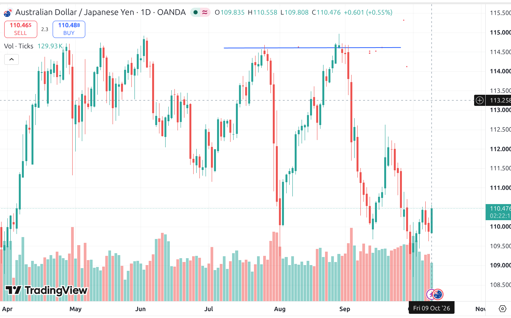

# Trader Project — Semi-Automated Trading Bot: Development Plan

| Item | Detail |
|---|---|
| Owner | Zeeshan |
| Document version | **v1.5** (living document — every change is recorded in [Section 11](#11-change-log) and in Git history) |
| Date | 11 October 2026 |
| Status | Plan agreed in principle; **Phase 0 in progress** — Ubuntu toolchain ready; IC Markets demo confirmed Hedging / Raw Spread; Open API app submitted (awaiting approval); setup checklist in [docs/setup.md](setup.md). Exit logic: Scenario 1 defined; position structure, scale-out and pyramiding defined ([Section 10.8](#108-position-structure-scale-out-and-pyramiding)). Scenarios 2–5 pending. |

## Contents

1. [Purpose in one paragraph](#1-purpose-in-one-paragraph)
2. [Key decisions at a glance](#2-key-decisions-at-a-glance)
3. [How the pieces fit](#3-how-the-pieces-fit)
4. [Human interaction via TradingView](#4-human-interaction-via-tradingview)
5. [Bot via cTrader Open API](#5-bot-via-ctrader-open-api)
6. [First bot: the Audit Bot](#6-first-bot-the-audit-bot)
7. [Execution environment: Ubuntu](#7-execution-environment-ubuntu)
8. [Phased roadmap](#8-phased-roadmap)
9. [Risk guardrails](#9-risk-guardrails-apply-from-phase-4)
10. [Exit logic: hedge-and-recover](#10-exit-logic-hedge-and-recover-no-stop-loss-for-risk)
11. [Change log](#11-change-log)
12. [Open items / decisions pending](#12-open-items--decisions-pending)
13. [Glossary](#13-glossary)

---

## 1. Purpose in one paragraph

Resume short-to-mid-term trend trading with a semi-automated setup. The human reads the market and makes decisions on TradingView; a bot written in C# executes and manages trades through the cTrader Open API on an Ubuntu machine, using raw-spread (ECN/STP-style) broker accounts. The first bot is an Audit Bot that measures, with evidence, how fairly two brokers price and fill orders before any real money is committed.

## 2. Key decisions at a glance

| # | Area | Decision | Why |
|---|---|---|---|
| 1 | Human interaction | TradingView (browser) | Best charts; works on Ubuntu; no install |
| 2 | Bot ↔ broker | cTrader Open API | Native on Linux; direct to broker; no Windows needed |
| 3 | Bot language | C# on **.NET 10 LTS** *(changed v1.4; was .NET 8)* | Best-documented cTrader route; runs natively on Linux. .NET 8 and 9 reach end of support on 10 Nov 2026; .NET 10 is supported to Nov 2028 and is in Ubuntu's own archive |
| 4 | First bot | Audit Bot on 2 brokers | Prove execution quality before trading strategy |
| 5 | Execution environment | Ubuntu (home PC → Linux VPS later) | Existing machine; same code moves to VPS |
| 6 | Plan document | Markdown in the private GitHub repo (`docs/plan.md`); Word/PDF exported when needed | Single source of truth next to the code; full change history *(changed v1.3; was .docx in Google Drive)* |
| 7 | Change control | All future changes go into this document | Version table + change log (Section 11) + Git commits |
| 8 | Broker candidates | Two of: Pepperstone, IC Markets, FP Markets, Fusion. **Broker A = IC Markets** (cTrader demo created 11-Oct-2026, Hedging, Raw Spread) *(v1.4, v1.5)*; Broker B still to choose | Raw spreads, cTrader, crypto CFDs, regulated groups |
| 9 | Trading style | Naked price action; real trades are shorts | Trader's own method (ex-Chris Capre student) |
| 10 | Loss control | Opposite-side hedge order instead of a stop-loss (Section 10) | Trader's design; specified scenario by scenario |
| 11 | Position structure | Every trade = 2 half-size shorts + 2 half-size hedges, with numbered legs (Section 10.8) *(new v1.3)* | Clean scale-out; each pair has its own exit |
| 12 | Trade management | Runner leg trails on M5; rotating leg closes when the next pyramid add opens; unlimited adds within an exposure cap *(new v1.3)* | Ride the trend while bounding total exposure |

## 3. How the pieces fit

```
YOU ──► TradingView (browser) : read trend, decide, (later) send alerts
              │ optional webhook (Phase 4)
              ▼
        Ubuntu machine
┌───────────────────────────────────────────────┐
│ Bot engine (C# / .NET worker service)         │
│  • own price & candle feed from broker        │
│  • rules, risk sizing, hedge logic, exits     │
│  • per-broker / per-instance logs on disk     │
└───────────────┬───────────────────────────────┘
                │ cTrader Open API (TLS, Protobuf)
                ▼
   Broker A (cTrader)        Broker B (cTrader)
```

> **Important:** the bot never reads TradingView charts. It gets its own prices from the broker — the same prices it trades on. TradingView is the human's window, and later an optional signal source.

## 4. Human interaction via TradingView

### 4.1 What the human does

- Reads the higher-timeframe trend (D1 / H4) and picks candidate markets.
- Marks levels, decides direction and when to engage (opens Trade 1 of each sequence).
- Monitors open positions (manually, or via TradingView-broker chart integration where the broker supports it).

### 4.2 How a human decision reaches the bot (staged)

| Stage | Method | Notes |
|---|---|---|
| Phase 1–3 | None needed | Audit Bot and backtests run on their own |
| Phase 4a | Bot config file / small local dashboard | Human sets symbol, direction, risk %; bot executes |
| Phase 4b | TradingView alert → webhook → bot | Needs a paid TradingView plan with webhooks and a secure public HTTPS endpoint (e.g. Cloudflare Tunnel). Bot validates a shared secret before acting. |

> **Guardrail:** a TradingView alert can only request an action. The bot re-checks risk limits, spread and account state before placing any order.

> **v1.3 note:** after the human opens Trade 1, the bot itself opens pyramid adds (Section 10.8, rule R4). This moves trade management from semi-automated toward automated; every add still passes the same risk checks.

## 5. Bot via cTrader Open API

### 5.1 Building blocks

- One Open API application registered on Spotware's Open API portal (client ID + secret).
- One cTrader ID (cTID) linked to both broker demo accounts; OAuth grants the app access to each account.
- .NET worker service using Spotware's official OpenAPI.Net library (NuGet `cTrader.OpenAPI.Net`) for the TCP/Protobuf connection.
- Demo and live use separate API hosts: `demo.ctraderapi.com:5035` and `live.ctraderapi.com:5035` (Protobuf over TLS; confirmed v1.4). One connection serves all demo accounts; a second serves all live accounts.
- Access token lasts about 30 days; the bot renews it with the refresh token and must save the new refresh token each time (the old one is invalidated).

> **Library risk (v1.4):** `cTrader.OpenAPI.Net` v1.4.4 was last published in 2022 and targets .NET 6, with old dependencies. It runs on .NET 10, so Phase 1 starts with it. Fallback if it causes problems: generate C# classes from Spotware's `.proto` files and write a thin TLS client.

### 5.2 Core functions the bot framework must provide

- Connect, authenticate application, authenticate each account, heartbeat, auto-reconnect.
- Subscribe to live spots (bid/ask) and candles (trendbars) per symbol — including M5 trendbars for the 21 EMA and trailing logic.
- Place / modify / close orders; always attach broker-side protection (hedge order or, once in profit, a stop-loss — see Section 10).
- Receive execution events (fills, rejections) and reconcile positions on reconnect, rebuilding leg pairs from their labels.
- Respect Open API request-rate limits (shared budget per connection) — trailing stops and 4-leg trades increase order-modify traffic.
- Structured logging (Serilog) in UTC timestamps.

## 6. First bot: the Audit Bot

### 6.1 Goal

Run the same measurements on two brokers in parallel for at least 2 weeks on demo accounts, then compare execution quality with data instead of marketing claims.

### 6.2 What it measures

| Measurement | How | Why it matters |
|---|---|---|
| Spread | Log every bid/ask tick per symbol | Real cost; widening at news/rollover |
| Slippage | Small scheduled probe orders (0.01 lot): requested vs filled price | Shows fill fairness, positive vs negative slippage |
| Execution latency | Time from order send → fill event | Speed of the broker path |
| Rejections / requotes | Count and reason codes | Hidden friction |
| Swap & commission | Read from deal/position data | Cost of holding trend trades |
| Feed gaps | Gaps > N seconds in ticks | Feed stability |

Symbols for v1: EURUSD, GBPUSD, USDJPY, XAUUSD, US500 (index), BTCUSD. Probe orders open and close immediately, during defined windows (London open, NY open, a quiet hour, around one news release).

### 6.3 Per-broker logging on disk

Each broker gets its own folder; each running instance gets its own sub-folder. Nothing is shared between brokers.

```
~/tradebot/
  config/
    audit.brokerA.json            # account id, symbols, probe schedule
    audit.brokerB.json
  run/instances/                  # live instance registry (heartbeat files)
    brokerA-<accountId>-<instanceId>.json
  logs/
    brokerA/<accountId>/<instanceId>/2026-10-12/
      ticks.csv    # time_utc, symbol, bid, ask, spread
      probes.csv   # time_utc, symbol, side, req_px, fill_px, slip, latency_ms
      events.log   # connect, reconnect, errors, rejections
    brokerB/<accountId>/<instanceId>/2026-10-12/ ...
  reports/
    daily-compare-2026-10-12.csv
```

### 6.4 Multi-instance awareness ("know your siblings")

Each instance must know how many copies of the Audit Bot are running and behave sensibly.

- **Identity:** on start, an instance creates an ID = broker + account + short GUID and writes it into its log path.
- **Registry:** it writes a heartbeat file in `run/instances/` every 10 seconds (PID, broker, account, symbols, role, last-seen time). Files older than 30 seconds are treated as dead and cleaned up.
- **Discovery:** each instance reads the registry to know the total count, and the count per broker/account.
- **Tactful behaviour:**
  - Different brokers → instances run fully independently.
  - Same broker + same account → the first instance is Primary (may send probe orders); later ones become Passive (log ticks only) to avoid duplicate trades.
  - Probe schedules are staggered by a few seconds between instances so they never fire together.
  - Every order carries a label with the instance ID, so fills are attributed to the correct instance.
  - If the Primary dies, the oldest live Passive instance promotes itself after the heartbeat timeout.
- **Visibility:** each instance logs the current sibling count on start, on change, and hourly.

### 6.5 Output

- Daily comparison CSV per broker: median/95th-percentile spread, average slippage, latency, rejection count.
- Final 2-week summary → broker choice recorded in this document.

## 7. Execution environment: Ubuntu

| Component | Choice |
|---|---|
| OS | Ubuntu (current machine) |
| Runtime / SDK | .NET 10 LTS SDK from Ubuntu's archive (`dotnet-sdk-10.0`); runtime only on the VPS later *(v1.4)* |
| Editor | VS Code + C# Dev Kit (AI-assisted coding) |
| Running the bot | systemd service (one unit per instance) → later Docker container |
| Secrets | API client secret and tokens in `~/.config/trader/secrets.env` (permissions 600) — never in Git |
| Setup check | `scripts/check-env.sh` — read-only check of OS, .NET, Git, VS Code, clock, port 5035, folders, secrets *(v1.4)* |
| Version control | Private Git repository (this repo — holds the plan and the code) |
| Clock | NTP sync enabled; all logs in UTC |
| Later | Small Linux VPS near broker servers (London / New York); same container |

> **Protection rule:** because home power or internet can drop, every live position must be protected by an order held on the broker's server. Before 1R this is the leg's hedge buy-stop; from 1R onward it is the leg's server-side trailing stop-loss (Section 10.8).

## 8. Phased roadmap

| Phase | Name | Deliverable | Target |
|---|---|---|---|
| 0 | Setup | Demo accounts at 2 brokers, cTID linked, Open API app, .NET + VS Code on Ubuntu, Git repo. Checklist: [docs/setup.md](setup.md). *Started 11-Oct-2026: Git repo done, IC Markets demo created and checked, Ubuntu toolchain ready, Open API app submitted.* | Week 1 |
| 1 | Framework + Audit Bot | Connect/auth/reconnect, spot & candle feed, probe orders, per-broker logs, instance registry | Weeks 2–3 |
| 2 | Audit run | 2 brokers × 2 weeks on demo; daily reports; choose broker | Weeks 4–5 |
| 3 | Backtesting | Strategy and exit rules (incl. Section 10 scenarios and 10.8 scale-out/pyramid rules) written as a spec; backtest with broker data incl. costs; hedge version vs net-position version compared | Weeks 6–8 |
| 4 | Trend bot + human link | Semi-auto execution, hedge-and-recover exit logic, 4-leg structure, trailing and pyramiding, dashboard/config, then TradingView webhook | Weeks 9–12 |
| 5 | Go-live (small) | VPS deployment, small live account, strict risk limits, review after 1 month | After Phase 4 |

## 9. Risk guardrails (apply from Phase 4)

- **Risk per trade:** 1% of equity to the hedge trigger level (adjustable, never above 2%). Applies to every pyramid add individually.
- **Daily loss limit:** bot stops new entries (including pyramid adds) for the day after a set loss.
- Maximum open positions and maximum total exposure caps.
- **Exposure cap for pyramiding (v1.3):** no new add if, after the add, effective leverage would exceed **1:10** or margin level would fall below **300%**. Both values are parameters. There is no cap on the number of adds.
- No trade if spread exceeds a per-symbol threshold.
- Effective leverage typically under 1:10 even if the account allows 1:500.
- **Kill switch:** one command closes all bot positions (including hedges) and stops the service.

## 10. Exit logic: hedge-and-recover (no stop-loss for risk)

*New in v1.1, updated v1.2 and v1.3.* Scenario 1 is defined below and illustrated with a real AUD/JPY chart (Figure 1). v1.3 adds the position structure, leg naming, scale-out and pyramiding rules (Section 10.8). Scenarios 2–5 will be added in a later session.

### 10.1 Concept

- The real trade is always a **SHORT** position.
- Instead of a stop-loss, the bot places a pending **BUY-STOP** order (the hedge) above the short entry. If price rises to that level, the hedge opens and the short's loss stops growing.
- The LONG side is used only as a hedge, never as a real trade.
- Once the hedge is safely in profit, the bot protects it with an exit just above its own entry. If the move against the short turns out to be a wick, the hedge closes at about break-even and the short continues.
- "No stop-loss" applies to **risk**. Once a short leg is 1R in profit, a stop-loss is used to **lock in** gains (Section 10.8).

### 10.2 Terms and parameters

| Symbol | Meaning | Set by |
|---|---|---|
| E | Short entry price (real trade) | Trader / strategy |
| H | Hedge trigger level: price of the pending buy-stop. Working assumption: H = E + ~10 pips | Trader (working assumption, to be tested) |
| Fh | Actual hedge fill price (H plus any slippage) | Market |
| A | Arming distance: how far price must rise above Fh before the hedge exit is placed ("a bit more") | Parameter — value to be set in backtest |
| X | Hedge exit = Fh + 1 pip (a sell-stop on the hedge) | Rule |
| T | Profit target / exit of the short | Trader / strategy |
| Size | Each hedge leg = the size of its own short leg (each = ½ of trade size). Full hedge, per pair. | Confirmed v1.3 |
| 1R | Profit equal to the distance risked: (H − E). With H = E + 10 pips, 1R = 10 pips | Rule (v1.3) |

### 10.3 Scenario 1 — wick against the short, then the down-move resumes

Market path: price rises through H, makes a spike (wick) higher, then reverses and falls back below H and on toward the short's target. Only one whipsaw against the main position.



*Figure 1 — AUD/JPY daily (OANDA, TradingView). Blue line = short entry E ≈ 114.62 (July high retested in September). The early-September wick to ≈ 114.97 is the single whipsaw; price then fell to ≈ 109.7 in mid-September.*

| Step | Market event | Bot action | Position after the step |
|---|---|---|---|
| 1 | Trader takes the short | Open SHORT at E. Place BUY-STOP hedge at H (same size). | Short open; hedge pending |
| 2 | Price rises to H | Hedge fills at Fh. Bot does nothing else yet — it waits. | Short + long = net zero. Short's loss frozen at (Fh − E). |
| 3 | Price rises a further A above Fh | Arm the hedge exit: place SELL-STOP on the hedge at X = Fh + 1 pip. | Hedge now protected at about break-even |
| 4 | Spike reverses (the wick) | Price falls to X → hedge closes at about +1 pip. | Only the short remains open |
| 5 | Down-move resumes | Short is managed by the rules in Section 10.8 (trailing, adds) until closed. | Flat |

**Result of Scenario 1:** hedge ≈ +1 pip (before slippage); short = (E − T) pips profit. A normal stop-loss at H would have closed the short at a loss on the wick and missed the move.

### 10.4 Worked example — real AUD/JPY levels from Figure 1 (1 lot)

| Item | Value |
|---|---|
| Short entry E (blue line) | 114.62 |
| Hedge buy-stop H = E + 10 pips (fill Fh) | 114.72 |
| Arming distance A (example) | 15 pips → hedge exit armed when price reaches 114.87 |
| Wick high | 114.97 (25 pips beyond Fh, so the exit arms) |
| Hedge exit X = Fh + 1 pip | 114.73 → hedge closes +1 pip on the way down |
| Short target T (example) | 110.00 → short closes +462 pips |
| Total (before costs) | +463 pips ≈ $3,100 at ~$6.76 per pip (USD/JPY ≈ 148 assumed) |
| Costs to subtract | Spread on short and on hedge (zero-commission account: cost is in the spread), plus swap for nights held |

> **Key constraint shown by this chart:** Scenario 1 only happens when the wick extends at least A beyond the hedge fill. Here the wick gave 25 pips of room above Fh, so A must be below about 25 pips. With a larger A, or a smaller wick, the hedge exit never arms and the trade falls into Scenario 2.

### 10.5 Equivalent rule on a single net position (for backtesting)

Economically, Scenario 1 is the same as: close the short at H, then re-open the short when price falls back to Fh + 1 pip after having risen at least A above Fh. Exposure, profit/loss and spread paid are the same at every moment. The backtest will run both versions side by side; matching results confirm the logic, and the live version can use whichever the trader prefers. The difference that remains is swap and margin while both legs are open.

### 10.6 Requirements for Scenario 1 to work

- The cTrader account must be a **hedging** account (long and short on the same symbol at the same time).
- The hedge buy-stop is held on the broker's server from the moment the short opens, so the short stays protected if the bot or home internet goes down.
- Every order carries a label linking the short and its hedge, so the bot can reconcile both legs after a reconnect (naming in Section 10.8.2).
- Pip size, spread and slippage are taken from the broker's symbol data, not hard-coded.

### 10.7 Scenarios still to be defined

- **Scenario 2** — hedge fills, then price falls back before the hedge exit is armed (price never reaches Fh + A).
- **Scenario 3** — chop around H (whipsaw): hedge opens and closes repeatedly; each cycle costs spread.
- **Scenario 4** — sustained trend against the short: hedge never closes; both legs stay locked. When and how to unwind.
- **Scenario 5** — gaps and news spikes: hedge buy-stop fills far beyond H. (Its effect is multiplied by pyramiding — see 10.8.6.)

### 10.8 Position structure, scale-out and pyramiding

*New in v1.3.* Applies after a trade is on track: either it never needed its hedge, or Scenario 1 completed and the hedge closed at about break-even. The trader accepts the risk of whipsaw and of the hedge exit not arming (Scenarios 2–3) as part of this design.

#### 10.8.1 Split structure

- Every trade is opened as **two half-size shorts and two half-size hedge buy-stops**. Example: a 1-lot trade = 2 × 0.5-lot shorts + 2 × 0.5-lot buy-stops.
- Both shorts sit at the same entry E. Both hedges sit at the same trigger level H.
- Each short is paired with its own hedge, so closing a pair never requires resizing an order.
- Minimum trade size is therefore 2 × the broker's minimum volume (e.g. 0.02 lots), and the trade size must split into two valid volume steps.

#### 10.8.2 Leg naming convention

Leg numbers keep counting up across trades. Trade *n* uses the odd/even pair of numbers (2n − 1, 2n). The label is written into each order's label/comment field and is used to rebuild pairs after a reconnect.

| Trade | Runner pair (odd) | Rotating pair (even) |
|---|---|---|
| T1 | T1-S1-L1 | T1-S2-L2 |
| T2 | T2-S3-L3 | T2-S4-L4 |
| T3 | T3-S5-L5 | T3-S6-L6 |
| Tn | Tn-S(2n−1)-L(2n−1) | Tn-S(2n)-L(2n) |

S = short leg, L = its hedge (long buy-stop). Odd legs are **runners**; even legs are **rotating** legs.

#### 10.8.3 Lifecycle rules

| Rule | Trigger | Bot action |
|---|---|---|
| **R1** Entry | Trader decides to short (Trade 1 of a sequence) | Open both shorts at E; place both hedge buy-stops at H. Size = 1% risk to H. |
| **R2** Protect at 1R | A short leg reaches 1R profit (price ≤ E − (H − E)) | First place a server-side stop-loss at E (break-even) or better on that leg; **then** cancel its hedge buy-stop (or close it if filled). Order matters: the leg is never left unprotected. |
| **R3** Trailing | Each M5 candle that closes below the 21 EMA | Move each protected leg's stop to just above the most recent M5 lower high (plus a spread buffer). Stops only move down, never up. |
| **R4** Pyramid add | An M5 candle closes back at the 21 EMA (retracement), **and** the latest trade has already reached 1R | Bot opens the next trade Tn+1 with the same 4-leg structure at the new entry; its hedges at new E + 10 pips; size = 1% risk to its own H. |
| **R5** Rotation | Trade Tn+1 is filled | Close the even (rotating) leg of the previous trade Tn, e.g. T2 opening closes T1-S2. Because of R2 this leg is already in profit when it closes. |
| **R6** Runners | Ongoing | Odd legs (S1, S3, S5…) stay open on trailing stops until stopped out. If no further add occurs, the latest even leg also keeps trailing. |
| **R7** Scope | Any add | Same symbol, short only. |
| **R8** Guards | Before every add | Previous trade ≥ 1R; spread below threshold; daily loss limit not hit; exposure cap respected (Section 9: effective leverage ≤ 1:10 and margin level ≥ 300% after the add). No limit on the number of adds. |

Effect: the position pyramids by half a trade per add. Older runners sit on stops in profit, while only the newest trade carries fresh risk, so open risk stays close to one trade's 1%.

#### 10.8.4 Illustration (levels from Figure 1, 1-lot trade)

| Event | Legs open | Protection |
|---|---|---|
| T1 opened at E = 114.62 | T1-S1, T1-S2 (0.5 each) | L1, L2 buy-stops at 114.72 |
| Price reaches 114.52 (1R = 10 pips) | T1-S1, T1-S2 | Stops at ≤ 114.62 placed, then L1 and L2 cancelled |
| Trend continues; M5 closes below 21 EMA | T1-S1, T1-S2 | Stops trail above each new M5 lower high |
| M5 retraces to 21 EMA → T2 opens | T1-S1, T2-S3, T2-S4 | T1-S2 closed in profit; L3, L4 at T2 entry + 10 pips |
| T2 reaches 1R | T1-S1, T2-S3, T2-S4 | All on trailing stops; next add allowed |

*Exact prices for adds depend on where the retracement happens; the table shows the sequence, not a backtest result.*

#### 10.8.5 Implementation notes for the bot

- Build M5 trendbars and the 21 EMA from the broker's own candle feed (same prices the bot trades on).
- "Last lower high" = the highest high of the most recent completed M5 swing below the 21 EMA; the exact swing definition is fixed in the Phase 3 spec and tested.
- Track each leg's state: `pending-hedge → hedged → protected (stop in profit) → trailing → closed`.
- On reconnect, rebuild all pairs from labels and re-check that every open short has either a hedge or a stop on the server.
- Stop modifications on many legs share the API rate budget; batch them per M5 candle close.

#### 10.8.6 Accepted risks and worst case

| Accepted risk | Worst case | How it is bounded |
|---|---|---|
| Gap or news spike through all trailing stops at once | All runners fill with heavy slippage on a large combined size; locked profit can turn into a loss | Exposure cap (leverage ≤ 1:10, margin level ≥ 300%); news filter to be added with Scenario 5 |
| Retracement deeper than expected after an add | New trade hits its hedge; older runners give back part of their open profit | Each add risks only 1%; older legs are at break-even or better |
| Spread paid on every add and every leg | Higher cost in choppy trends | Spread filter; adds only after 1R |
| M5 trailing exits early in a healthy pullback | Runner closes before the trend ends | Accepted; next retracement add re-enters the trend |
| Whipsaw / hedge exit not arming (Scenarios 2–3) | Small loss or locked position on a trade | Accepted by trader; rules to follow in Scenarios 2–3 |

## 11. Change log

Every change is recorded here, the version number in the header table is increased, and the change is committed to Git with a matching message.

| Version | Date | Change |
|---|---|---|
| v1.0 | 08-Oct-2026 | First issue. Decisions: TradingView for human interaction; cTrader Open API; C#; Audit Bot first on 2 brokers with per-broker logs and multi-instance awareness; Ubuntu; plan stored as .docx in Google Drive. |
| v1.1 | 09-Oct-2026 | Added Section 10: hedge-and-recover exit logic (no stop-loss; shorts as real trades, longs as hedge), Scenario 1 defined with worked example and net-position equivalent; Scenarios 2–5 listed. Decisions 9–10 added to Section 2. Sections 5.2, 7, 8 and 9 aligned to the hedge design. Open items and glossary updated. Sections renumbered (change log now 11). |
| v1.2 | 09-Oct-2026 | Scenario 1 illustrated with AUD/JPY daily chart (Figure 1). Working assumption H = E + ~10 pips. Worked example replaced with real levels (E 114.62, H 114.72, wick 114.97, T 110.00). Constraint on arming distance A added. |
| v1.3 | 10-Oct-2026 | Plan moved from .docx to Markdown in the private GitHub repo (`docs/plan.md`, chart in `docs/images/`); decision 6 updated. Added Section 10.8: 4-leg split structure, leg naming Tn-S(2n−1)/S(2n), lifecycle rules R1–R8 (protect at 1R, M5 trailing above last lower high with 21 EMA close, bot-opened pyramid adds on retracement to 21 EMA, rotation of even legs, runners), illustration, implementation notes, accepted risks. Hedge size confirmed per pair; 1R defined. Exposure cap for pyramiding added to Section 9. Decisions 11–12 added. Sections 4, 5.2, 7, 8, 10.1, 10.2, open items and glossary aligned. |
| v1.4 | 11-Oct-2026 | Phase 0 started: setup checklist `docs/setup.md` and check script `scripts/check-env.sh` added. Runtime changed from .NET 8 to .NET 10 LTS (decision 3, Section 7) because .NET 8/9 support ends 10-Nov-2026. IC Markets confirmed as Broker A (demo created). Open API endpoints and token lifetimes confirmed (Section 5.1); OpenAPI.Net library age noted as a risk with fallback. Open items and glossary updated. |
| v1.5 | 11-Oct-2026 | Phase 0 progress: Ubuntu toolchain ready (`check-env.sh` no failures; .NET 10 SDK, C# Dev Kit, runtime folders, secrets file; NTP fixed by using `pk.pool.ntp.org` as the default time servers are blocked on the home network — see setup.md 4.4). IC Markets demo confirmed Hedging, Raw Spread, USD, 1:500 (decision 8). Open API app "Trend Audit Bot" submitted (ID 43770, trading permission on own accounts). Change-log rows put in version order. Open items updated. |

## 12. Open items / decisions pending

- Which two brokers to audit: **IC Markets chosen as Broker A** (v1.4); choose Broker B from Pepperstone, FP Markets, Fusion Markets, and open its cTrader demo with the same cTrader ID.
- ~~*(v1.4)* IC Markets demo: confirm Hedging mode and account type (Raw Spread vs Standard).~~ Done v1.5: Hedging, Raw Spread, USD, 1:500.
- *(v1.4)* Open API application: ~~submit~~ (submitted 11-Oct-2026, app ID 43770, v1.5), await Spotware approval, obtain tokens (setup.md Step 3).
- TradingView plan level (webhooks need a paid tier) — decide before Phase 4b.
- Final symbol list for the Audit Bot.
- Price-action entry rules (to be written as a spec in Phase 3).
- Hedge design: test H = E + ~10 pips as the working assumption; choose the arming distance A (must be smaller than typical wick extensions beyond Fh). Full-size hedge per pair: confirmed v1.3.
- Hedge design: define Scenarios 2–5 (Section 10.7).
- *(v1.3)* Fix the exact M5 swing definition for "last lower high" and the stop buffer (pips above the high).
- *(v1.3)* Confirm the 21 EMA retracement trigger: candle close at/above the EMA vs. a touch of the EMA.
- *(v1.3)* Confirm exposure-cap values (effective leverage 1:10, margin level 300%) after the Audit Bot shows real margin requirements.
- Account type: zero-commission (Standard, spread-only) vs raw-spread + commission for the hedge design — compare using Audit Bot data. *(v1.5: Broker A demo is Raw Spread.)*
- Protection if power/internet drops: confirm the server-side hedge order (before 1R) and stop-loss (after 1R) are sufficient, or add a wide emergency stop-loss as a last-resort backstop.
- Short-only approach: confirm instruments, and check swap direction for shorts on each one.

## 13. Glossary

| Term | Meaning |
|---|---|
| ECN / STP | Broker models that pass orders to external liquidity providers instead of trading against the client. |
| Raw spread | Interbank price with no mark-up; broker earns a separate commission. |
| cTrader Open API | Spotware's interface that lets external programs trade cTrader accounts over TLS using Protobuf messages. |
| Protobuf | Compact binary message format (Google Protocol Buffers). |
| OAuth | Token-based authorisation; the bot never stores your account password. |
| Slippage | Difference between requested price and actual fill price. |
| Trendbar | A candle (open, high, low, close) for a given timeframe. |
| Webhook | An HTTP POST sent automatically by one system (e.g. TradingView) to a URL when an event fires. |
| systemd service | Linux mechanism that keeps a program running in the background and restarts it on failure. |
| Heartbeat | A periodic "I am alive" signal; missing heartbeats mean the instance is dead. |
| Trailing stop | A stop-loss that follows price in your favour to lock in profit during a trend. |
| Hedge | An opposite-side position on the same symbol that freezes the open loss of the real trade. |
| Buy-stop / Sell-stop | Pending orders that open (or close) a position when price rises to / falls to a set level. |
| Arming distance (A) | How far price must move beyond the hedge fill before the bot places the hedge's exit. |
| Hedging vs netting account | Hedging allows long and short on the same symbol at once; netting keeps a single net position. |
| Whipsaw | A sharp move one way quickly followed by a sharp move back. |
| Swap | Overnight financing charged or paid for holding a position past the daily rollover. |
| 1R | A profit equal to the amount originally risked (here the distance from E to H). |
| Pyramiding | Adding to a winning position in steps as the trend proves itself. |
| Runner leg | The odd-numbered half of each trade, kept open on a trailing stop for the whole trend. |
| Rotating leg | The even-numbered half of each trade, closed in profit when the next pyramid add opens. |
| 21 EMA | Exponential moving average of the last 21 candle closes, weighting recent prices more heavily. |
| Lower high | In a downtrend, a swing high that is lower than the previous swing high. |
| Effective leverage | Total position value divided by account equity. |
| Margin level | Equity divided by used margin, as a percentage; low values lead to margin calls. |
| Markdown | A plain-text format where simple symbols (`#`, `|`, `**`) become headings, tables and bold text when displayed. |
| Commit | A saved snapshot of the repository with a short message describing what changed. |
| LTS (Long-Term Support) | A software release that receives security fixes for an extended period (3 years for .NET). |
| Access token / refresh token | OAuth keys: the access token lets the app act on granted accounts for a limited time; the refresh token is used only to obtain a new access token. |
| Client ID / Client Secret | The identity and password of the *application* (the bot), issued by Spotware when the Open API app is approved. |
